# MARÉE — schémas d’architecture

_Ce document rassemble les schémas du système, du plus large au plus fin.
Chaque schéma est un bloc Mermaid : il se rend tel quel dans GitHub,
VS Code, Obsidian ou Notion, et reste lisible dans un diff._

Date : 2026-11-04

> Convention de lecture : les nœuds disent **ce qui se passe**, la légende
> sous chaque schéma dit **où le vérifier dans le code**. Un schéma qui ne
> renvoie pas à un fichier n’aurait pas sa place ici.

---

## Sommaire

| Niveau | Schéma | Question à laquelle il répond |
|---|---|---|
| 0 | Contexte | Qui parle à qui ? |
| 1 | Couches / ports | Pourquoi c’est remplaçable ? |
| 2 | Un tick | Que se passe-t-il en 10 s simulées ? |
| 3 | Graphe LangGraph | Comment un agent décide ? |
| 3 bis | Déclencheurs | Quand décide-t-il ? |
| 4 | Modèle mémoire | De quoi se souvient-il ? |
| 4 bis | Séquence mémoire | Comment la mémoire est-elle lue et écrite ? |
| 4 ter | Cloisonnement | Pourquoi ne peut-il pas tricher ? |
| 5 | Pipeline RAG | Que lit-il, et sous quels filtres ? |
| 5 bis | Pas de base vectorielle | Pourquoi un fichier suffit ? |
| 6 | Événements / Kafka | Qu’est-ce qui circule ? |
| 6 bis | Enveloppe d’événement | Que porte chaque fait ? |
| 7 | Journal / rejeu | Comment prouve-t-on tout ça ? |
| 7 bis | Chaîne causale | Pourquoi la foule a-t-elle basculé ? |

---

## Niveau 0 — Contexte : qui parle à qui

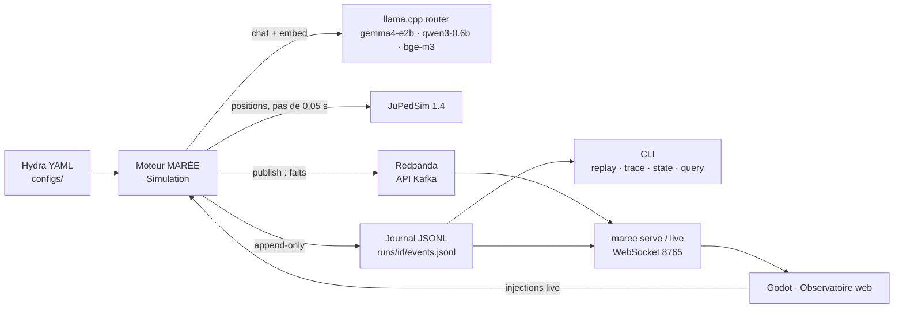

**Où le vérifier** : `src/maree/cli.py` (`_build`), `docker-compose.yml`,
`docs/architecture-v2.md` §11.

---

## Niveau 1 — Couches et ports/adaptateurs

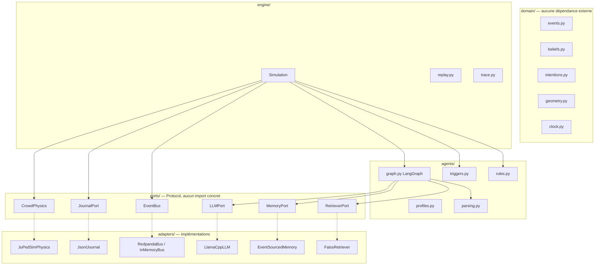

**Où le vérifier** : `src/maree/ports/__init__.py` pour les contrats ;
`src/maree/adapters/` pour les implémentations. Le domaine ne connaît aucun
outil : c’est ce qui permet les tests sans GPU, sans Kafka, sans JuPedSim.

---

## Niveau 2 — Un tick, pas à pas

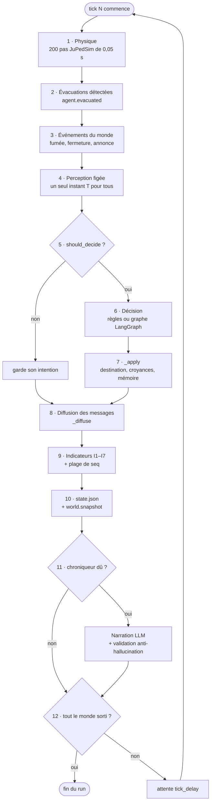

**Où le vérifier** : `src/maree/engine/simulation.py`, boucle `run()`
(lignes ~695-830). L’ordre n’est pas cosmétique : la perception est figée
avant les décisions, et les messages sont diffusés après leur application.

---

## Niveau 3 — Le graphe de décision (LangGraph)

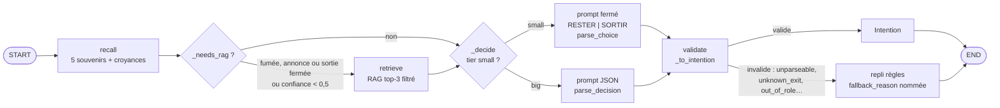

**Où le vérifier** : `src/maree/agents/graph.py` (`_build`, `_recall`,
`_needs_rag`, `_retrieve`, `_decide`, `_validate`).

---

## Niveau 3 bis — Les déclencheurs, par ordre de priorité

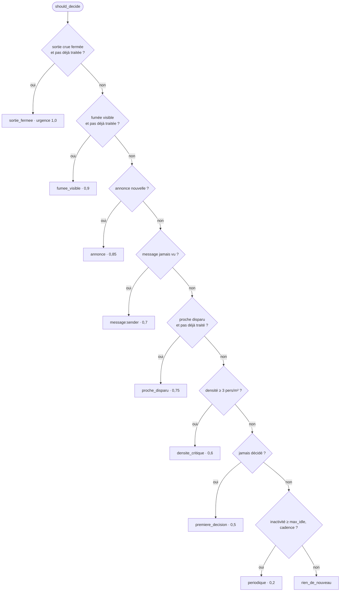

**Où le vérifier** : `src/maree/agents/triggers.py`. Les signaux persistants
sont des **fronts** : `known_signals` empêche la fumée, visible jusqu’à la
fin, de redéclencher une décision à chaque tick.

---

## Niveau 4 — Le modèle de mémoire

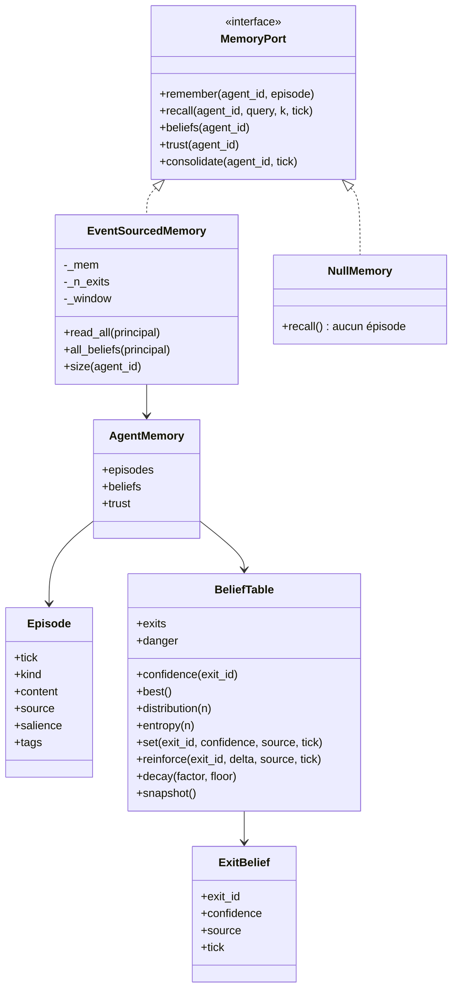

**Où le vérifier** : `src/maree/memory/store.py`,
`src/maree/domain/beliefs.py`, `src/maree/ports/__init__.py`.
`kind ∈ {vu, entendu, dit, decide, resume}`. Le champ `trust` existe dans le
contrat mais n’est pas encore branché à la décision — c’est une extension,
pas un mécanisme actif.

---

## Niveau 4 bis — Cycle de vie d’une mémoire, sur une décision

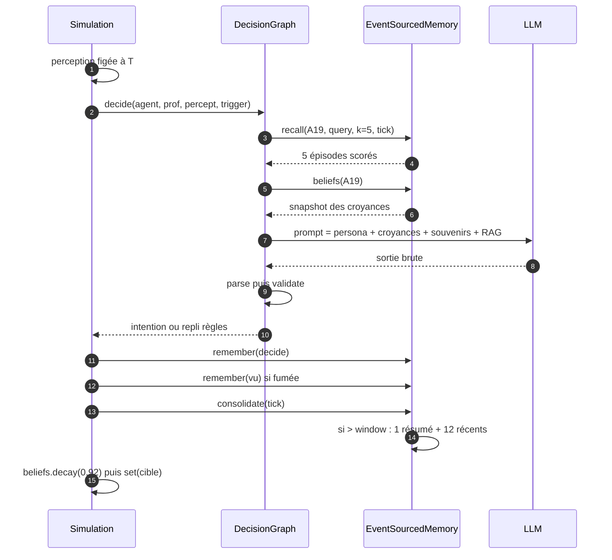

**Où le vérifier** : `DecisionGraph._recall` et `Simulation._apply`. L’écriture
de croyance passe par la **décision**, jamais directement par un message reçu :
un message entre en mémoire épisodique et dans le prompt ; la décision
suivante l’adopte ou non.

---

## Niveau 4 ter — Cloisonnement, la garantie centrale

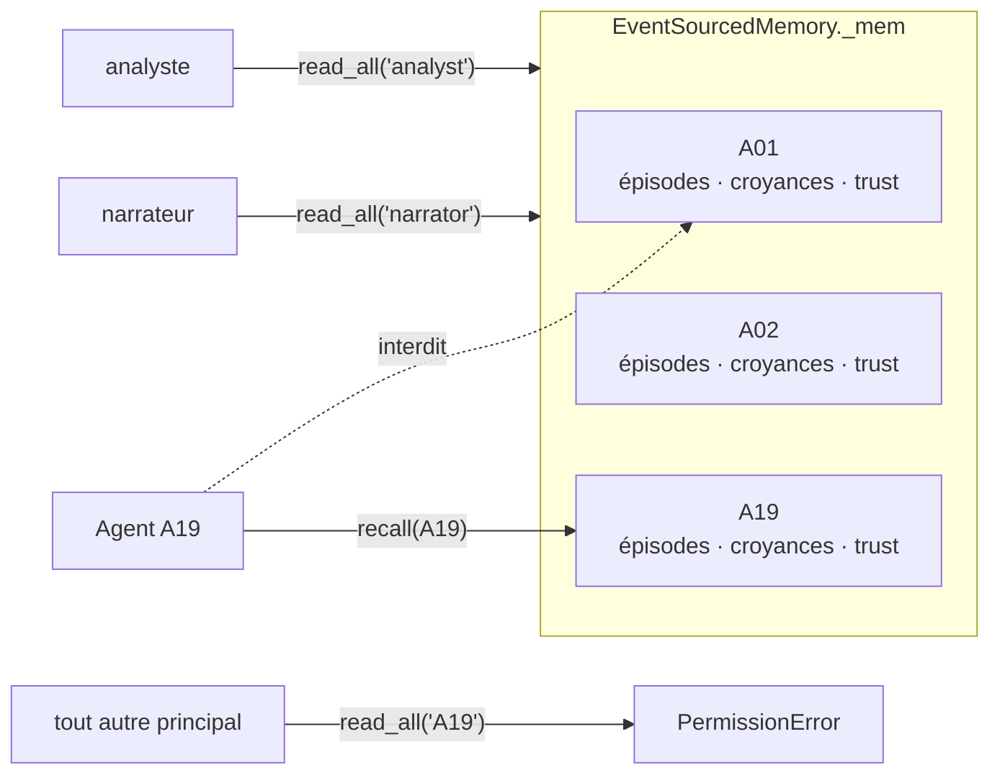

**Où le vérifier** : `tests/test_memory.py`, testé par propriété (Hypothesis,
50 exemples). Sans cette garantie, un visiteur « saurait » ce qu’un habitué
sait, et l’expérience ne mesurerait plus la circulation d’une croyance.

---

## Niveau 5 — Le pipeline RAG

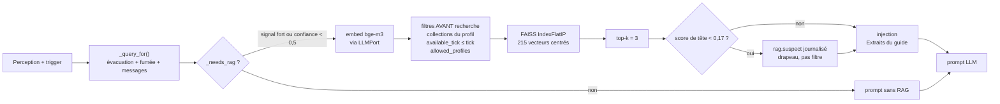

**Où le vérifier** : `src/maree/adapters/retrieval/faiss_corpus.py`,
`configs/rag/bge_m3_faiss.yaml`. Le centrage sur la moyenne du corpus n’est
pas un détail : il fait passer la précision@1 de 0,17 à 0,73.

---

## Niveau 5 bis — Pourquoi pas de base vectorielle

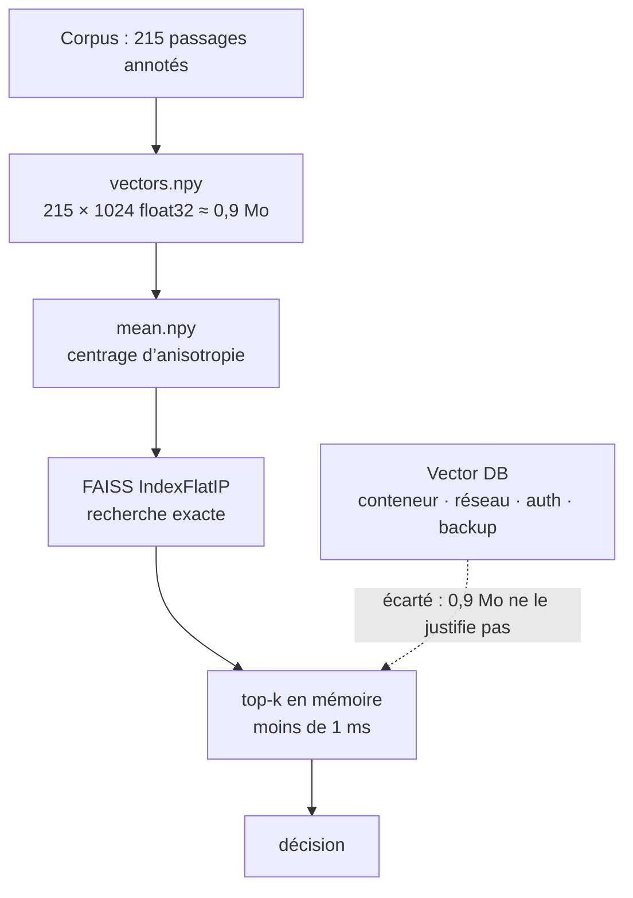

**Où le vérifier** : `docs/architecture-v2.md` §9 et §10. Le corpus est figé,
annoté, et le seul traitement qui compte (le centrage) tiendrait en trois
lignes de numpy.

---

## Niveau 6 — Les événements, du moteur jusqu’aux consommateurs

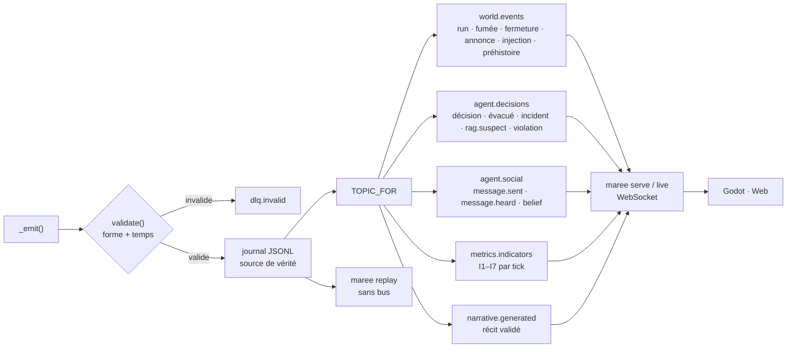

**Où le vérifier** : `TOPIC_FOR` dans `src/maree/engine/simulation.py`.
Ne sont **pas** publiés : `world.snapshot` (61 à 89 % des octets d’un run) et
`tick`. Le bus transporte des **faits**, pas de l’**état** ; le journal reste
la source de vérité, et un broker mort ne tue pas un run rejouable.

---

## Niveau 6 bis — Enveloppe d’un événement

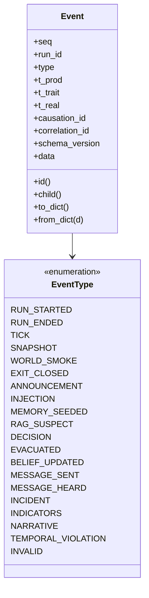

**Où le vérifier** : `src/maree/domain/events.py`. `t_prod` est le tick de
production, `t_trait` celui du traitement ; `causation_id` est rempli
mécaniquement par `Event.child()`, jamais à la main.

---

## Niveau 7 — Journal, rejeu et trace

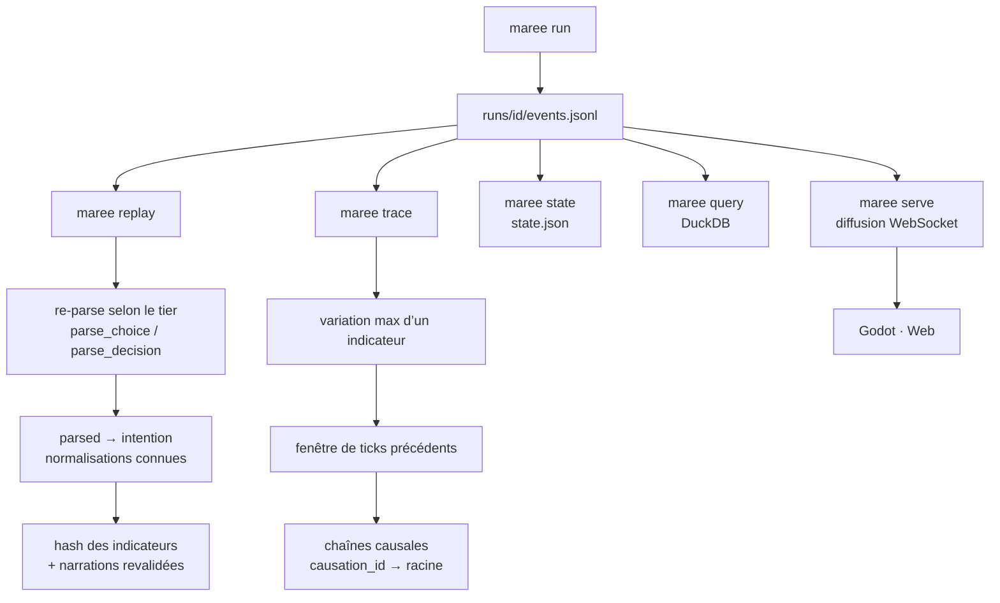

**Où le vérifier** : `src/maree/engine/replay.py`,
`src/maree/engine/trace.py`, `src/maree/cli.py`. Le rejeu ne fait **aucun**
appel LLM ni Kafka ; un journal sans `run.ended` est refusé, pas « réparé ».

---

## Niveau 7 bis — La chaîne causale (B4)

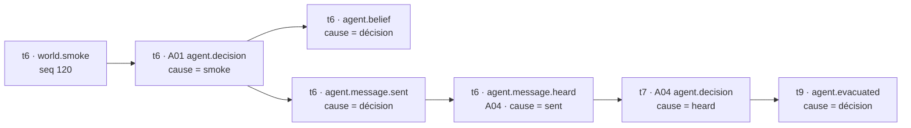

**Où le vérifier** : `src/maree/engine/trace.py`. `correlation_id` est la
racine de toute la chaîne ; `ancestors()` la remonte sans boucler, et la CLI
`maree trace` l’affiche tick par tick.

---

## Ce que ces schémas ne disent pas

Trois limites, écrites ici plutôt que découvertes en soutenance :

- **Le store mémoire vit en RAM.** Le journal contient de quoi reconstruire
  les épisodes, mais `EventSourcedMemory` n’est pas rechargé depuis le
  journal au démarrage : le nom est prospectif.
- **`control.commands` n’est pas utilisé par le moteur.** Les injections
  arrivent par WebSocket (`maree live`) et sont journalisées comme
  `control.injection` dans `world.events`. Le topic existe dans le
  `docker-compose` et le `Makefile` pour un pilotage externe, pas encore
  branché.
- **La mémoire sociale (`trust`) est un contrat sans effet.** Le champ est
  stocké et cloisonné, mais aucune décision ne le lit aujourd’hui.
