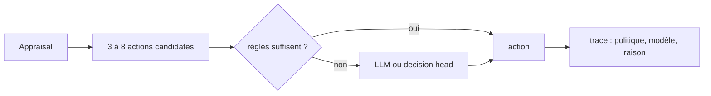
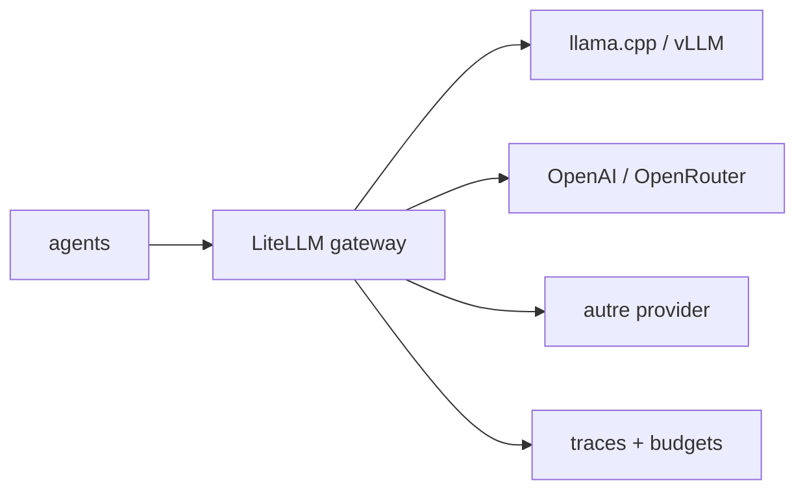

# Agents, politiques et LLM

_Ce document décrit comment un agent choisit son action, comment on branche
des modèles de tailles différentes, et comment on évalue une tête de décision
rapide comme OpenJev._

---

## 1. Le registre de politiques

Un agent n'est pas « un LLM ». C'est un **archétype + une politique + un modèle
optionnel**.

```yaml
policies:
  rules:
    kind: rules
    description: règles + traits, aucun LLM

  hybrid:
    kind: hybrid
    llm: small
    decision_head: openjev
    llm_when: [ambiguity, announcement, rumour]

  llm_small:
    kind: llm
    model: qwen3-0.6b

  llm_big:
    kind: llm
    model: gemma4-27b

  decision:
    kind: decision_head
    model: openjev-1.7b

agents:
  - { id: A01, archetype: visiteur, policy: hybrid,    seed: 42 }
  - { id: A02, archetype: habitue, policy: llm_big,   seed: 43 }
  - { id: A03, archetype: securite, policy: rules,     seed: 44 }
  - { id: A04, archetype: famille, policy: decision,  seed: 45 }
```

Le moteur journalise **quelle politique et quel modèle** ont décidé, et le coût.

---

## 2. Catalogue de modèles

Le nom du modèle dans une politique est un **nom logique**, pas un fichier.

```yaml
models:
  qwen3-0.6b:
    provider: litellm_proxy
    model: openai/qwen3-0.6b
    revision: "2026-10"
    capabilities: [json, seed]
    context: 8192
    cost_per_mtok: { input: 0.0, output: 0.0 }

  gemma4-27b:
    provider: litellm_proxy
    model: openai/gemma4-27b
    revision: "2026-09"
    capabilities: [json, seed, vision]
    context: 32768
```

### Chaîne de résolution

```text
agent.model
  → policy.model
    → tier (big/small)
      → catalogue default
```

Chaque niveau peut être `null`. La résolution est **journalisée** :

```json
{
  "requested_model": "gemma4-27b",
  "resolved_model": "openai/gemma4-27b",
  "provider": "litellm_proxy",
  "revision": "2026-09",
  "fallback": false
}
```

---

## 3. La politique hybride (défaut)



Quand appeler le LLM :

- annonce officielle ambiguë ;
- rumeur ou information contradictoire ;
- situation jamais vue ;
- demande d'explication ou de justification.

Quand ne pas l'appeler :

- routine (sortir, rester, suivre) ;
- calcul de trajectoire ;
- chaque tick.

C'est ce qui rend 60–200 agents tenables.

---

## 4. OpenJev comme tête de décision

### 4.1 Ce que c'est

OpenJev est une famille de **modèles de décision « System-One »** :

- entrée : un état + un ensemble fini d'options (`choice`, `oui/non`, `score`) ;
- sortie : une **probabilité calibrée par option**, en **un seul passage** ;
- pas de génération de texte, pas de parsing ;
- ~20–200 ms selon le modèle et la taille de l'entrée.

Tailles : 1.7B / 4B / 8B (Apache-2.0), 27B (Loop, **CC-BY-NC-4.0**).

### 4.2 Où il s'insère

```text
appraisal → actions candidates → OpenJev → probabilités
                                        │
                                        ▼
                    choix final = probabilités × traits × utilité
```

Le modèle **ne décide pas seul** : il score. Les traits, les règles et
l'utilité gardent le dernier mot. C'est ce qui permet de garder le contrôle
et d'expliquer la décision.

### 4.3 Ce qu'il apporte

- coût et latence : des centaines d'agents sans des centaines d'appels LLM ;
- calibration : on peut seuiller et mesurer l'incertitude ;
- pas de parsing : la distribution est directement exploitable.

### 4.4 Ce qu'il n'apporte pas

- pas de raisonnement multi-étapes ;
- l'accuracy chute quand l'état d'un même agent est mis à jour plusieurs fois
  (interférence entre enregistrements similaires) ;
- il suit un résumé périmé sans le signaler ;
- le 1.7B est **anglais seulement** ;
- licence variable : vérifier Apache vs non commercial.

### 4.5 Évaluation avant adoption

On ne l'adopte pas sur la foi d'un benchmark externe. On construit un banc
de **300 à 500 situations issues de nos scénarios** :

| Bras | Ce qu'on mesure |
|---|---|
| règles | accuracy, calibration, latence |
| OpenJev | accuracy, Brier, ECE, latence |
| LLM | accuracy, coût, latence |

Critère d'adoption :

- OpenJev bat les règles sur au moins deux points de décision ;
- sa calibration est meilleure que celle du LLM ;
- son coût est compatible avec 60–200 agents.

Sinon, on garde les règles et on réserve OpenJev à la recherche.

---

## 5. La passerelle LLM

### 5.1 Pourquoi une passerelle

Aujourd'hui, la v2 code `LlamaCppLLM` en dur, avec `extra_body` llama.cpp,
une heuristique 404 sur le texte, et les embeddings sur le même client.
C'est intenable si un utilisateur veut un autre provider.

### 5.2 Cible



- **LiteLLM** (MIT) fournit l'API unifiée, les fallbacks, les budgets, les
  virtual keys, les traces.
- Le noyau ne connaît qu'un endpoint OpenAI-compatible + un catalogue.
- Les embeddings ont leur **propre port** (`EmbedderPort`), indépendant du chat.

### 5.3 Structured outputs

- `json_schema` quand le modèle le supporte ;
- parseur tolérant sinon ;
- le protocole `RESTER/SORTIR` devient une propriété du couple (modèle, agent),
  pas un booléen global.

### 5.4 Ce que la trace doit contenir

```json
{
  "provider": "litellm_proxy",
  "requested_model": "gemma4-27b",
  "resolved_model": "openai/gemma4-27b",
  "revision": "2026-09",
  "request_id": "req_...",
  "finish_reason": "stop",
  "tokens_in": 742,
  "tokens_out": 48,
  "duration_s": 2.73,
  "seed_requested": 1234,
  "seed_honored": true,
  "fallback": false,
  "prompt_template": "decision/v3",
  "prompt_hash": "..."
}
```

---

## 6. Budgets et gouvernance

| Budget | Portée | Effet |
|---|---|---|
| `max_calls_per_agent` | agent | coupe les boucles |
| `max_tokens_per_agent` | agent | coût |
| `max_wall_time` | run | durée |
| `max_concurrency` | run | charge |
| `cost_ceiling` | run | coût |

Un dépassement est **journalisé** et produit un incident, pas un arrêt silencieux.

---

## 7. Agents personnalisés

Un utilisateur doit pouvoir définir un agent **sans toucher au code** :

```yaml
archetypes:
  photographe:
    label: Photographe amateur
    traits:
      risk_aversion: 0.7
      herding: 0.4
      altruism: 0.3
      spatial_confidence: 0.5
      mobility: 0.6
      authority_trust: 0.5
      kin_attachment: 0.2
      impulsivity: 0.6
    policy: hybrid
    model: llm_small
    bio: |
      Venue pour couvrir l'événement, encombré de matériel.
    knows: [X_NORTH, X_SOUTH]
```

Le registre valide le schéma, résout la politique et le modèle, et journalise
la définition complète.

---

## 8. Déterminisme et non-déterminisme

| Source | Politique |
|---|---|
| Règles | déterministe par graine |
| OpenJev | déterministe à entrée égale (si le backend l'est) |
| LLM local | graine transmise, `seed_honored` journalisé |
| LLM distant | non déterministe assumé, jamais utilisé pour une preuve de rejeu |

**Règle** : un run destiné à la validation utilise `rules` ou `hybrid` avec
traces complètes. Un run `llm` est une exploration, pas une preuve.

---

## 9. Ce qu'on ne fait pas

- pas d'appel LLM par tick ;
- pas de LLM pour calculer une trajectoire ;
- pas de prompt système qui contient le contrat JSON pour un petit modèle ;
- pas de modèle « par défaut » invisible : tout est dans le catalogue ;
- pas de fallback silencieux : un repli est un incident journalisé.
