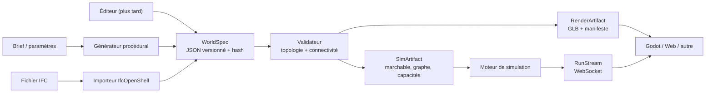
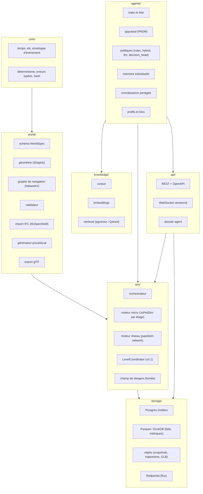
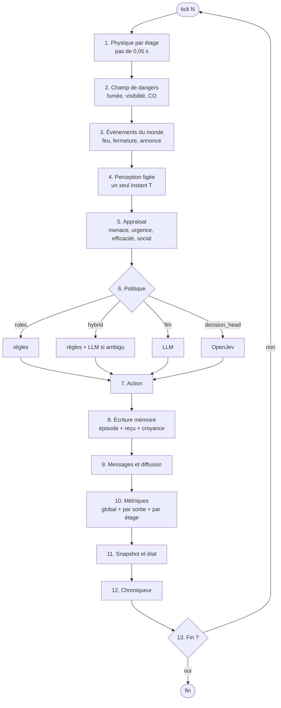

# Architecture v3

_Ce document décrit les artefacts, les couches et les contrats._
_Il ne décrit pas l'implémentation : il décrit ce qui doit rester vrai
quand l'implémentation changera._

---

## 1. Principes

1. **Noyau headless.** Aucune logique de rendu dans le moteur. Godot est un client.
2. **Le monde est un artefact versionné**, pas un YAML lu au démarrage.
3. **Trois plans de données séparés** : vérité du monde, connaissance partagée,
   mémoire individuelle.
4. **Faits ≠ état ≠ connaissance.** Le journal garde les faits ; l'état est un
   cache reconstructible ; la connaissance est une projection datée.
5. **Contrats avant implémentations.** Chaque couche expose un `Protocol` et un
   JSON Schema.
6. **Traçabilité complète.** Monde, modèle, prompt, graine, corpus, version.
7. **Aucune revendication sans vérification.**

---

## 2. Les quatre artefacts

C'est la distinction centrale de la v3. Elle règle à la fois le multi-étages,
le rendu 3D, le procédural et l'API.

| Artefact | Propriétaire | Contenu | Cycle de vie |
|---|---|---|---|
| **WorldSpec** | `world/` | étages, espaces, portes, escaliers, sorties, obstacles, dangers, occupation | immuable, versionné, hashé |
| **SimArtifact** | `world/` → `sim/` | polygones marchables, graphe de navigation, capacités, zones de spawn | dérivé, reconstructible |
| **RenderArtifact** | `world/` → `render/` | glTF 2.0, matériaux, LOD, manifeste d'IDs | dérivé, reconstructible |
| **RunStream** | `engine/` → `api/` | agents, croyances, décisions, fumée, métriques | dynamique, journalisé |

**Règle** : aucun artefact dérivé n'est édité à la main. Si le rendu est faux,
on corrige le WorldSpec ou l'export, pas le GLB.

---

## 3. Couches et paquets

### Rôles des paquets

| Paquet | Responsabilité | Ne fait pas |
|---|---|---|
| `core/` | temps, ids, événements, déterminisme, erreurs | aucune règle métier |
| `world/` | schéma, géométrie, validation, import, génération, export | aucune décision d'agent |
| `sim/` | physique, orchestration, dangers, transferts | aucune cognition |
| `agents/` | traits, appraisal, politiques, mémoire, connaissance | aucune physique |
| `knowledge/` | corpus, embeddings, retrieval | aucune mémoire individuelle |
| `storage/` | persistance, requêtes, migrations | aucune règle métier |
| `api/` | REST, WS, dossier, schémas | aucun calcul de simulation |
| `verify/` | ISO 20414, validation comportementale, golden runs | aucune production |

---

## 4. Les ports

Chaque dépendance externe est derrière un `Protocol`.

| Port | Implémentation v3.0 | Remplacement prévu |
|---|---|---|
| `WorldSource` | `IfcWorldSource`, `ProceduralWorldSource` | éditeur, autre import |
| `CrowdPhysics` | `JuPedSimPerLevel` | autre moteur |
| `NetworkEgress` | `JuPedSimNetwork` | moteur maison, calcul analytique |
| `HazardModel` | `CoarseSmokeField` | `FdsImportedField` (v3.1) |
| `ChatModelPort` | `OpenAICompatibleChat` via LiteLLM | tout provider |
| `DecisionHeadPort` | `OpenJevHead` (optionnel) | règles, autre modèle |
| `EmbedderPort` | `BgeM3Embedder` | tout embedder |
| `KnowledgeStore` | `PgVectorKnowledgeStore` | Qdrant, LanceDB |
| `AgentMemory` | `EventSourcedAgentMemory` | store distant |
| `RunStore` | `PostgresRunStore` | autre relationnel |
| `EventStore` | `ParquetEventStore` | objet, colonnaire |
| `ArtifactStore` | `S3ObjectStore` | MinIO, FS |
| `EventBus` | `RedpandaBus` | mémoire, autre bus |

**Règle** : le domaine et le moteur n'importent aucun adaptateur concret.
L'assemblage se fait dans un seul fichier (`bootstrap.py`), comme la CLI v2.

---

## 5. Flux d'un tick

Points non négociables :

- la perception est **figée** avant les décisions ;
- l'ordre d'application est **canonique** (par `agent_id`) ;
- les messages sont diffusés **après** l'application des décisions ;
- les métriques sont calculées **après** la diffusion ;
- le snapshot est un **état dérivé**, pas la source de vérité.

---

## 6. Dépendances externes

| Besoin | Brique | Licence | Rôle |
|---|---|---|---|
| Foule micro 2D | JuPedSim 1.4.x | LGPLv3+ | physique par étage |
| Foule réseau multi-niveaux | jupedsim-network 0.5.x | LGPLv3+ | écrantage grossier |
| Géométrie | Shapely | BSD | polygones, distances, contenance |
| Graphe | NetworkX | BSD | navigation, connectivité |
| IFC | IfcOpenShell 0.9.x | LGPLv3+ | import BIM |
| Rendu | glTF 2.0 | Khronos | contrat de rendu |
| Front | Godot 4.x | MIT | observatoire 3D |
| Assets | Mixamo, Quaternius, Kenney, Poly Haven | variable | personnages, décors |
| Feu (v3.1) | FDS / CFAST | domaine public (NIST) | champs de fumée |
| Base | PostgreSQL + pgvector | PostgreSQL / BSD | métier + vecteurs |
| Analytique | DuckDB + Parquet | MIT / Apache | faits, métriques |
| Objets | MinIO / S3 | AGPL / commercial | snapshots, GLB |
| Flux | Redpanda | BSL | diffusion temps réel |
| API | FastAPI | MIT | REST + OpenAPI |
| Gateway LLM | LiteLLM | MIT | providers, budgets, traces |
| V&V | ISO 20414:2020 | standard | protocole de vérification |
| Navigation code | Graphify | Apache-2.0 / MIT | outil de développement |

**Ce qu'on n'écrit pas** : moteur de foule, moteur de feu, base de données,
index vectoriel, serveur HTTP, auth, moteur de rendu. Voir `decisions.md`.

---

## 7. Versioning et compatibilité

| Objet | Version | Politique |
|---|---|---|
| `WorldSpec` | `world_schema` | rupture majeure = nouveau champ, migration explicite |
| Événements | `event_schema` | un upcast par version, refus si inconnue |
| API REST | `/v1` | dépréciation annoncée |
| WebSocket | `protocol_version` | négociation au `hello` |
| Dossier agent | `dossier_schema` | sections additives |
| Index vectoriel | manifeste | modèle, dimension, centrage, hash du corpus |
| Run | `config_hash` | inclut monde, modèles, corpus, prompts |

**Aucune rétrocompatibilité v2.** Les runs v2 ne sont pas rejoués par la v3.

---

## 8. Ce qui reste vrai de la v2

- journal append-only, `seq` canonique, `causation_id` ;
- déterminisme par graine dérivée ;
- décisions événementielles (front, pas niveau) ;
- séparation ports / adaptateurs ;
- rejeu sans LLM ni Kafka ;
- le chroniqueur est omniscient et stérile.
