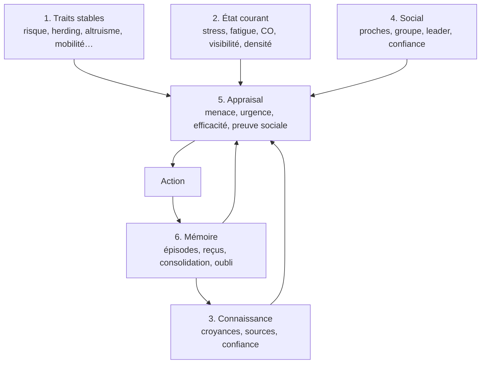

# Comportement, mémoire et individualité

_C'est le document central de la v3. La mission 1 est le comportement humain,
pas l'architecture. Tout le reste sert ce document._

---

## 1. Ce qu'on veut démontrer

> Deux agents du même archétype, placés dans la même situation, ne se
> comportent pas de la même façon **parce qu'ils n'ont pas la même mémoire**.

C'est une affirmation testable. Elle se mesure, elle s'ablate, elle se publie.

Ce qu'on ne veut pas :

- un LLM qui « fait humain » en surface, sans régularité mesurable ;
- des agents identiques qui divergent par la température du modèle ;
- une mémoire décorative qui n'influence aucune décision.

---

## 2. Les six couches



---

## 3. Traits stables (l'archétype)

Un archétype est un **jeu de traits**, pas un caractère littéraire.
Les valeurs par défaut sont des points de départ à calibrer.

| Trait | Échelle | Effet principal |
|---|---|---|
| `risk_aversion` | 0..1 | seuil de menace avant de bouger |
| `herding` | 0..1 | poids de l'observation des autres |
| `altruism` | 0..1 | probabilité d'aider, de guider |
| `spatial_confidence` | 0..1 | confiance dans sa connaissance des lieux |
| `mobility` | 0..1 | vitesse, handicaps, encombrement |
| `authority_trust` | 0..1 | poids d'une annonce officielle |
| `kin_attachment` | 0..1 | priorité donnée à la recherche d'un proche |
| `impulsivity` | 0..1 | passage à l'acte sans vérification |
| `noise_sensitivity` | 0..1 | réaction aux cris, alarmes, bruits |

Deux agents du même archétype partagent ces traits. **Ils diffèrent par
l'histoire, la mémoire et les liens sociaux.**

---

## 4. État courant

| Variable | Unité | Source | Effet |
|---|---|---|---|
| `stress` | 0..1 | menace, densité, durée, bruit | accélère ou fige |
| `fatigue` | 0..1 | temps, effort | réduit la vitesse |
| `co_exposure` | ppm | champ de fumée | réduit les capacités |
| `visibility` | m | champ de fumée | change la direction |
| `crowding` | pers/m² | densité locale | ralentit, stresse |
| `injury` | bool | événement | réduit la mobilité |

---

## 5. Connaissance

```text
beliefs[exit] = (confidence, source, tick)
hazard_beliefs[zone] = (smoke, heat, blocked, source, tick)
route_knowledge = ce que je sais des couloirs, portes, escaliers
```

Chaque croyance porte **sa source** et **son tick** :

- `connu` : savoir initial du profil ;
- `vu` : observation directe ;
- `entendu:A12` : message d'un autre agent ;
- `annonce` : annonce officielle ;
- `guide` : consigne d'un agent de sécurité ;
- `rag:#42` : passage du corpus ;
- `rumeur` : information non vérifiée.

C'est ce qui rend une décision auditable : « il croyait B à 0,7, parce que
A12 le lui a dit à t=12, et il ne l'a pas vérifié ».

---

## 6. Social

| Élément | Sens |
|---|---|
| `kin` | proche(s) à retrouver |
| `group` | groupe de déplacement (famille, amis) |
| `leader` | personne dont le comportement est suivi |
| `trust[agent]` | confiance envers un émetteur (0..1) |
| `observed[agent]` | comportement observé récemment |

Le groupe n'est pas une abstraction : il a un **leader** éventuel, une
**cohésion** mesurable, et un **coût** à se séparer.

---

## 7. Appraisal (PADM)

À chaque événement, l'agent évalue cinq dimensions :

```text
menace        = f(fumée, chaleur, alarme, cris, visibilité, densité)
urgence       = f(menace, proximité, temps écoulé)
efficacité    = f(je connais une sortie, je sais quoi faire, je suis capable)
preuve sociale= f(ce que font les autres, ce qu'ils disent, confiance)
responsabilité= f(proches, rôle, groupe)
```

Puis choisit une **action protective** :

```text
rester
observer / chercher de l'information
évacuer vers une sortie
chercher un proche
aider / guider
suivre quelqu'un
revenir en arrière
```

L'appraisal est **journalisé** : c'est ce qui permet au front d'afficher
« ce à quoi il pense » autrement que par un monologue généré.

---

## 8. Mémoire

### 8.1 Trois plans

| Plan | Contenu | Qui écrit | Qui lit |
|---|---|---|---|
| **Vérité du monde** | sorties, fumée, positions, dangers | moteur | moteur, métriques |
| **Connaissance partagée** | annonces, fermetures, consignes, faits publics | moteur | agents **via perception** |
| **Mémoire individuelle** | épisodes, croyances, reçus, relations | agent/moteur | agent |

Un agent ne lit jamais la vérité du monde directement. Il lit une **perception
datée**, bornée par sa position, sa visibilité et son étage.

### 8.2 Épisodes

```text
Episode(
  tick,
  kind ∈ {vu, entendu, dit, decide, resume},
  content,
  source,
  salience,
  tags
)
```

### 8.3 Reçus

Chaque apprentissage laisse un reçu :

```text
Receipt(
  fact,          # "sortie B praticable", "fumée au niveau 2"
  source,        # agent, annonce, perception, RAG
  tick,
  confidence,
  derived_from   # id d'événement
)
```

C'est ce qui permet de répondre à « qu'est-ce que A19 savait à t=14, d'où le
tenait-il, et à quel point y croyait-il ? ».

### 8.4 Consolidation et oubli

- consolidation **déterministe** : les vieux épisodes deviennent un résumé
  (`plus tôt : 4 vu, 2 entendu, 3 decide`) ;
- oubli des croyances non renforcées : `decay(factor)` à chaque décision ;
- pas de consolidation par LLM : le rejeu doit être exact.

### 8.5 Ce qui n'entre pas en mémoire

- les passages RAG bruts (ils deviennent des croyances sourcées) ;
- les annonces (elles deviennent des faits partagés + reçus) ;
- la vérité du monde (jamais).

---

## 9. Individualité : l'expérience des jumeaux

### 9.1 Protocole

- deux cohortes A et B, **mêmes traits**, même archétype, même position ;
- seule différence : l'histoire personnelle (préhistoire, messages reçus,
  ce qu'ils ont vu) ;
- même graine de run, même géométrie, même fumée.

### 9.2 Mesures

| Mesure | Ce qu'elle dit |
|---|---|
| distribution des sorties | divergence de choix |
| délai de première décision | divergence de réactivité |
| longueur et forme du chemin | divergence d'itinéraire |
| taux d'aide / de guidage | divergence sociale |
| écart au groupe | cohésion |
| entropie des croyances | incertitude |
| KL divergence entre cohortes | **mesure principale** |

### 9.3 Critère d'acceptation

La divergence entre cohortes doit être :

- **mesurable** : KL > seuil sur au moins un phénomène ;
- **explicable** : chaque différence renvoie à un reçu ou à un épisode ;
- **ablatable** : mémoire désactivée → divergence nulle.

Sans l'ablation, on ne prouve rien.

---

## 10. Politiques de décision

| Politique | Qui décide | Usage |
|---|---|---|
| `rules` | règles + traits + utilité | routine, reproductible |
| `hybrid` | règles, LLM si ambiguïté | défaut |
| `llm` | LLM à chaque décision | recherche, démo |
| `decision_head` | OpenJev ou équivalent | scoring rapide d'options |

Le registre est décrit dans [`agents-et-llm.md`](agents-et-llm.md).

---

## 11. Phénomènes prioritaires

Quatre phénomènes, pas dix. Ils sont documentés, mesurables, et liés à la mémoire.

### P1 — Temps de pré-mouvement

- **Ce qu'on mesure** : délai entre le premier signal et le premier pas.
- **Cible** : distribution log-normale, calibrée sur la littérature (SFPE).
- **Test** : KS sur un échantillon de 200 agents.
- **Ce qui le fait varier** : archétype, annonce, autorité, fumée visible.

### P2 — Choix de sortie sous incertitude

- **Ce qu'on mesure** : distribution des sorties choisies.
- **Facteurs** : distance de chemin, congestion perçue, familiarité,
  information sociale, visibilité.
- **Test** : ablations (distance seule, puis + congestion, puis + social).
- **Ce qui le fait varier** : mémoire, messages, annonce, fermeture.

### P3 — Influence sociale et herding

- **Ce qu'on mesure** : part d'agents qui changent de sortie après un message
  ou en observant un comportement.
- **Cible** : effet significatif, croissant avec `herding` et l'incertitude.
- **Test** : comparaison avec et sans communication, à traits égaux.

### P4 — Cohésion du groupe et recherche des proches

- **Ce qu'on mesure** : taux de réunion, délai, écart au groupe.
- **Cible** : les agents `famille` se cherchent et se réunissent avant de sortir
  dans une majorité des cas.
- **Test** : scénario avec séparation forcée, mesure du délai de réunion.

### P5 — Réponse à la fumée (v3.1, mais perçue dès v3.0)

- **Ce qu'on mesure** : demi-tour, évitement, ralentissement quand la visibilité
  chute.
- **Cible** : seuil de visibilité sous lequel la majorité change de direction.
- **Test** : gradient de visibilité, mesure du taux de demi-tour.

---

## 12. Validation

### 12.1 Sources

- distributions de pré-mouvement (SFPE) ;
- relation vitesse / densité (Weidmann, Fruin) ;
- études de choix de sortie (distance, congestion, social) ;
- comportement de groupe (Sime, affiliation) ;
- protocole ISO 20414 pour la vérification des composants.

### 12.2 Protocole

1. **Vérification** : chaque composant fait ce qu'il prétend (tests unitaires).
2. **Calibration** : ajuster les paramètres sur un jeu de scénarios.
3. **Validation** : tester sur des scénarios **non utilisés** pour la calibration.
4. **Ablation** : mémoire off, social off, fumée off.

On ne dira jamais « validé » sans ces quatre étapes.

---

## 13. Risques

| Risque | Mitigation |
|---|---|
| Les agents paraissent humains en démo mais pas en distribution | validation sur scénarios tenus à l'écart |
| La mémoire n'a pas d'effet mesurable | expérience des jumeaux + ablation |
| Le LLM domine et rend le comportement non reproductible | politique `hybrid` par défaut, traces |
| Les traits sont des paramètres arbitraires | calibration sur la littérature, pas sur l'intuition |
| La fumée grossière ne provoque pas de comportement réaliste | seuils de visibilité calibrés, test de demi-tour |
| Le multi-étages est repoussé et casse le schéma | WorldSpec multi-étages dès la v3.0 |
