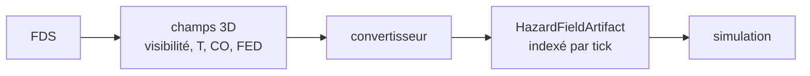

# Feu et fumée

_Le feu n'est pas la priorité de réalisme maximal. La priorité est qu'il
provoque des comportements crédibles, à un coût compatible avec des variantes
nombreuses._

---

## 1. Décision de périmètre

| Élément | v3.0 | v3.1 | Pourquoi |
|---|---|---|---|
| Départs de feu (position, étage, courbe HRR) | oui | oui | déclencheur |
| Fumée par étage (grille) | oui | oui | change le comportement |
| Visibilité | oui | oui | critère de ténabilité n°1 |
| CO / chaleur | simple | oui | stress, incapacité |
| Propagation des flammes | **non** | option FDS | coût énorme, gain comportemental faible |
| Radiation, sprinklers, effondrement | non | non | hors périmètre |
| CFD temps réel | non | non | incompatible avec le temps réel |
| FDS importé | non | oui | crédibilité des scénarios de conception |

**Résumé** : on simule un **champ de fumée grossier** et des **sources de feu**.
On ne simule pas la combustion.

---

## 2. Le modèle de fumée v3.0

### 2.1 Représentation

Une grille par étage, résolution 1 à 2 m :

```text
HazardField[level][ix, iy] = {
  soot: kg/m³,
  temperature_c: float,
  co_ppm: float,
  visibility_m: float,
  optical_density: 1/m
}
```

Le champ est mis à jour à chaque tick de cognition (10 s simulées), pas à
chaque pas physique.

### 2.2 Source

```yaml
hazard:
  id: F_1
  kind: fire
  level: L1
  position: [70, 40]
  hrr_kw: [[0,0],[60,250],[300,900]]
  soot_yield: 0.07
  co_yield: 0.02
```

À chaque tick :

- le débit de suie est proportionnel à la HRR ;
- la suie est injectée dans la cellule de la source ;
- elle est advectée par un champ de vent simple (par défaut nul) et diffusée.

### 2.3 Transport

```text
C(t+dt) = C(t)
        + diffusion  * ∇²C
        + advection  * (v · ∇C)
        + source
        - puits
```

- diffusion et advection sont des paramètres calibrés, pas des constantes
  physiques exactes ;
- le transport vertical passe par les **ouvertures** : escaliers, atrium,
  gaines. Une dalle sans ouverture ne laisse rien passer ;
- un escalier reçoit une fraction du flux de l'étage source.

### 2.4 Visibilité

La visibilité est dérivée de la densité optique :

```text
K = extinction_coefficient × concentration_de_suie
visibility = facteur / K
```

`facteur` vaut 3 pour une signalétique réfléchissante, 8 pour une signalétique
éclairée (valeurs de la littérature, à calibrer). C'est un **paramètre de
scénario**, pas une constante cachée.

### 2.5 Ténabilité

Seuils de travail, à documenter et à calibrer :

| Critère | Seuil | Effet |
|---|---|---|
| visibilité | < 10 m | gêne, ralentissement |
| visibilité | < 5 m | demi-tour fréquent, désorientation |
| température | > 60 °C | douleur, incapacité |
| CO | > 500 ppm | vertiges, ralentissement |
| FED | > 0,3 | incapacité progressive |

Ces seuils ne sont pas une certification : ce sont des **paramètres de
comportement**, avec une source citée.

---

## 3. Contrat `HazardField`

```python
class HazardField(Protocol):
    def sample(self, level: LevelId, point: Point, tick: Tick) -> HazardSample: ...
    def sources(self, tick: Tick) -> list[HazardSource]: ...
    def grid(self, level: LevelId, tick: Tick) -> HazardGrid: ...
    def advance(self, tick: Tick) -> None: ...
```

```python
@dataclass
class HazardSample:
    visibility_m: float
    temperature_c: float
    co_ppm: float
    fed: float
    smoke: bool
```

Les agents ne lisent **que** `sample` : ils ne connaissent ni la grille ni les
équations.

---

## 4. Couplage avec le comportement

| Perception | Effet comportemental |
|---|---|
| fumée visible au loin | alerte, recherche d'information |
| visibilité qui chute | ralentissement, demi-tour, changement de sortie |
| chaleur | évitement, panique |
| CO | ralentissement, erreurs |
| FED élevé | incapacité, effondrement |

Le couplage est **explicite** dans l'appraisal :

```text
menace = f(smoke, heat, co, visibility, alarme, cris)
```

Il est journalisé : on peut dire « il a fait demi-tour parce que la visibilité
est passée sous 5 m à t=23 ».

---

## 5. Événements

| Événement | Champs |
|---|---|
| `hazard.fire_started` | `source_id`, `level`, `position`, `hrr_kw` |
| `hazard.smoke_updated` | `level`, `tick`, `grid_hash`, `max_optical_density` |
| `hazard.visibility_dropped` | `level`, `zone`, `visibility_m`, `tick` |
| `hazard.extinguished` | `source_id`, `tick` |
| `agent.affected_by_smoke` | `agent_id`, `visibility_m`, `co_ppm`, `fed` |

Le champ complet n'est pas publié à chaque tick : on publie un **hash** et des
agrégats, et le front lit la grille par l'API si nécessaire.

---

## 6. Coût et performance

| Étage | Grille 1 m | Cellules | Coût par tick |
|---|---|---|---|
| 120 × 80 m | 1 m | 9 600 | négligeable |
| 10 étages | 1 m | 96 000 | quelques ms |
| 10 étages | 0,5 m | 384 000 | à éviter en temps réel |

On peut passer en 2 m pour les variantes, 1 m pour la démonstration.

---

## 7. v3.1 : import FDS



- FDS (NIST, domaine public) produit les champs ;
- un convertisseur les aligne sur la grille du WorldSpec ;
- la simulation les lit comme un `HazardField` immuable ;
- aucun couplage temps réel.

C'est la voie pour un scénario de conception crédible, sans payer le CFD à
chaque run.

---

## 8. Validation

| Test | Critère |
|---|---|
| source isolée | la suie reste dans la pièce sans ouverture |
| transport vertical | l'étage au-dessus se dégrade après l'étage source |
| visibilité | décroît avec la concentration |
| demi-tour | seuil de visibilité reproduit sur un gradient |
| conservation | pas de suie négative, pas de création spontanée |

---

## 9. Ce qu'on ne prétend pas

- ce n'est pas un modèle CFD ;
- ce n'est pas validé pour un usage réglementaire ;
- les constantes sont calibrées pour le comportement, pas pour la physique ;
- la propagation des flammes n'est pas simulée.

On l'écrit dans le rapport, pas en note de bas de page.
