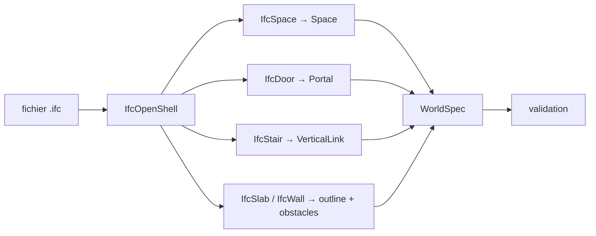
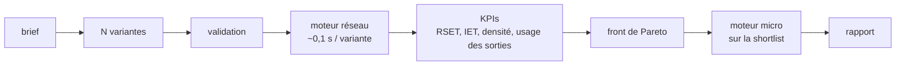
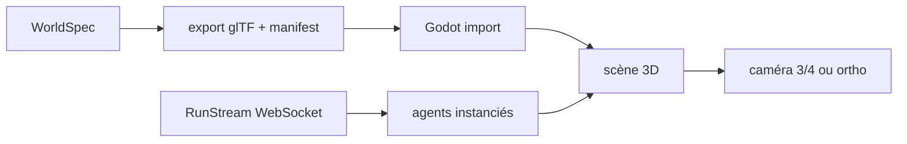

# Monde, procédural et rendu

_Ce document décrit le WorldSpec, sa validation, l'import IFC, la génération
procédurale, l'export glTF et le pipeline Godot._

---

## 1. Le WorldSpec

Le WorldSpec est la **vérité sémantique** du bâtiment. Il est versionné, hashé,
et journalisé au début de chaque run.

```yaml
world:
  id: mall_aubel
  version: 3
  schema: 3.0.0
  units: m
  coordinate_system: Z_UP          # le convertisseur glTF passe en Y_UP

  levels:
    - id: L0
      name: Rez-de-chaussée
      elevation: 0.0
      height: 4.5
      outline: [[0,0],[120,0],[120,80],[0,80]]
      holes: [[[40,30],[60,30],[60,50],[40,50]]]   # atrium
      spaces:
        - id: S_HALL
          kind: hall
          polygon: [[0,0],[120,0],[120,80],[0,80]]
          occupancy: 180
      portals:
        - id: P_HALL_CORR
          between: [S_HALL, S_CORR]
          segment: [[40,20],[42,20]]
          width: 2.0
          state: open
          capacity_p_s: 1.3
      exits:
        - id: X_NORTH
          level: L0
          segment: [[55,80],[60,80]]
          width: 5.0
          to: outside
      obstacles:
        - id: O_STAND_12
          polygon: [[20,20],[24,20],[24,24],[20,24]]
          height: 1.2
          kind: stand

  vertical:
    - id: ST_MAIN
      kind: stair                 # stair | escalator | elevator
      from: L0
      to: L1
      polygon: [[50,10],[53,10],[53,14],[50,14]]
      width: 2.4
      tread: 0.28
      riser: 0.18
      capacity_p_s: 1.1

  hazards:
    - id: F_1
      kind: fire
      level: L1
      position: [70, 40]
      hrr_kw: [[0,0],[60,250],[300,900]]
      soot_yield: 0.07
```

### Champs obligatoires

| Champ | Rôle |
|---|---|
| `id`, `version`, `schema` | identité et compatibilité |
| `units`, `coordinate_system` | conversion vers le rendu et la physique |
| `levels[]` | étages, élévations, hauteurs |
| `spaces[]` | pièces, zones, occupation |
| `portals[]` | portes internes, largeur, capacité, état |
| `exits[]` | sorties, étage, largeur, extérieur |
| `obstacles[]` | obstacles, hauteur, type |
| `vertical[]` | escaliers, ascenseurs, escalators |
| `hazards[]` | départs de feu, courbes, suie |

### Règles de validation (bloquantes)

1. IDs uniques dans tout le bâtiment.
2. Chaque étage a un `outline` valide, simple, avec trous inclus.
3. Chaque `space` est contenu dans son étage.
4. Chaque `portal` sépare deux espaces existants, ou un espace et l'extérieur.
5. Chaque `exit` est sur la frontière d'un espace ou de l'étage.
6. Chaque `vertical` relie deux étages existants.
7. Tout espace est **atteignable** depuis tout autre espace par des portails ouverts.
8. Tout espace a au moins un chemin vers une sortie ouverte.
9. Les obstacles sont dans un espace, pas sur une porte.
10. Les capacités et largeurs sont positives et cohérentes.

Un WorldSpec invalide est **refusé avec la raison**, pas corrigé en silence.

---

## 2. Géométrie et navigation

### 2.1 Contrat de géométrie

```python
class NavigationGraph(Protocol):
    def space_at(self, point: Point, level: LevelId) -> SpaceId | None: ...
    def reachable_exits(self, point: Point, level: LevelId) -> list[ExitId]: ...
    def path_distance(self, a: Point, b: Point, level: LevelId) -> float: ...
    def route(self, start: Point, goal: ExitId) -> Route: ...
    def line_of_sight(self, a: Point, b: Point, level: LevelId) -> bool: ...
    def sample_spawn(self, space: SpaceId, rng: Random) -> Point: ...
    def capacity(self, exit_id: ExitId) -> float: ...
    def bounds(self, level: LevelId) -> Bounds: ...
```

Ce contrat remplace la distance euclidienne de la v2 (`rules.py:122`).
Il permet :

- une sortie derrière un mur n'est pas « la plus proche » ;
- un escalier a un coût, pas une distance à vol d'oiseau ;
- un agent ne naît pas dans un obstacle.

### 2.2 Implémentation

- **Shapely** pour les polygones, trous, contenance, distances ;
- **NetworkX** pour le graphe espaces / portails / escaliers / sorties ;
- **Dijkstra** avec coûts : longueur, pénalité de densité, capacité, escalier ;
- **grille de navigation** pour le rendu du champ de distance, si nécessaire.

---

## 3. Import IFC

### 3.1 Chaîne



### 3.2 Règles

- un `IfcSpace` devient un `Space` avec son polygon et son étage ;
- un `IfcDoor` devient un `Portal` entre deux espaces adjacents ;
- un `IfcStair` devient un `VerticalLink` entre deux étages ;
- les `GlobalId` IFC sont conservés dans les `extras` du glTF ;
- les unités sont converties en mètres ;
- l'orientation est convertie de Z-up (IFC) vers Y-up (glTF) à l'export.

### 3.3 Limites

- l'IFC est souvent sale : portes sans espace adjacent, murs sans épaisseur,
  escaliers sans volée. Le validateur doit **refuser** ou **signaler**, pas deviner.
- l'import IFC est une extension (semaine 11) ; le WorldSpec manuel et le
  procédural passent en premier.

---

## 4. Génération procédurale

### 4.1 Objectif

Pas « générer un mall aléatoire ». Générer des **situations** qui permettent
d'explorer le comportement et les choix de conception.

### 4.2 Archétypes

| Archétype | Paramètres | Usage |
|---|---|---|
| `linear_mall` | longueur, largeur, boutiques, couloir, sorties | scénario de base |
| `atrium_mall` | atrium, anneau, escalators, étages | foule, visibilité |
| `l_mall` | deux ailes, angle, sorties | chemin plus long |
| `food_court` | stands, tables, densité | feu de cuisine, fumée |
| `cinema` | salles, couloirs, sorties | évacuation par blocs |

### 4.3 Algorithmes

- **croissance contrainte** (Lopes et al., 2010) : plans valides, multi-étages,
  connectivité garantie, < 100 ms ;
- **BSP / treemap** : découpage d'une emprise en lots ;
- **CP-SAT (OR-Tools)** : affectation des surfaces, adjacences, contraintes ;
- **grammaires de graphes** : relations entre pièces.

On implémente l'**assemblage** de ces algorithmes, pas un nouveau solveur.

### 4.4 Recherche de variantes



Les KPIs incluent des mesures **comportementales** : divergence, herding,
cohésion, choix de sortie. Pas seulement le temps d'évacuation.

### 4.5 Déterminisme

- graine → hash du WorldSpec ;
- même graine + mêmes paramètres → même plan ;
- le plan généré est journalisé et rejouable.

---

## 5. Le RenderArtifact (glTF)

### 5.1 Format

- **glTF 2.0 binaire (`.glb`)** pour la géométrie et les matériaux ;
- **`manifest.json`** pour le mapping IDs ↔ nœuds ↔ sémantique ;
- **textures séparées** si nécessaire (KTX2/Basis pour la performance).

### 5.2 Conventions

| Élément | Convention |
|---|---|
| Nœud d'étage | `L0`, `L1` |
| Nœud d'espace | `S_HALL` |
| Porte | `P_HALL_CORR` |
| Escalier | `ST_MAIN` |
| Sortie | `X_NORTH` |
| Obstacle | `O_STAND_12` |
| `extras` | `{ "id": "...", "kind": "...", "ifc_global_id": "..." }` |

Les IDs sont **stables** : le front les utilise pour lier un clic à un agent,
une porte, un indicateur.

### 5.3 Ce que le GLB contient

- sols, plafonds, murs, cloisons, obstacles ;
- portes (avec un nœud mobile ou un simple panneau) ;
- escaliers (volées, paliers) ;
- sorties (marquage) ;
- matériaux PBR simples.

Ce qu'il ne contient pas : les agents (ils sont instanciés par le front), la
fumée (elle est dynamique), les métriques (elles sont dans le flux).

---

## 6. Godot

### 6.1 Pipeline



### 6.2 Caméra

Deux presets, configurables :

- **perspective 3/4** (style BG3/Diablo) : angle 35–45°, zoom, orbite limitée ;
- **orthographique** (style SimCity) : projection isométrique stricte.

La caméra est un choix de front. Le noyau ne la connaît pas.

### 6.3 Agents

| Nombre | Technique |
|---|---|
| < 200 | scène individuelle, `AnimationPlayer`, ombres, LOD |
| 200–1 000 | `MultiMesh` + animation bakée en texture, ou shader d'instanciation |
| > 1 000 | LOD agressif, impostors, pas d'ombres individuelles |

Ce qui est réaliste en 3 mois : **60 agents animés**, avec des personnages
importés low-poly. Pas 5 000 agents AAA.

### 6.4 Assets

| Type | Sources | Format |
|---|---|---|
| Personnages | Mixamo, Quaternius, Kenney, Poly Pizza, VRM | glTF/GLB, FBX |
| Animations | Mixamo | FBX/glTF |
| Matériaux | Poly Haven, ambientCG | PBR |
| Mobilier | Kenney, Quaternius, Objaverse | glTF |

Règles :

- **manifeste de licences** par asset (nom, source, licence, auteur) ;
- éviter les licences non commerciales pour une publication ;
- retargeting humanoid dans Blender ou via Godot (`SkeletonProfileHumanoid`,
  `BoneMap` selon la version) ;
- pas de génération de personnages : on importe.

### 6.5 Multi-étages et occlusion

- chaque étage est un nœud séparé ;
- les étages supérieurs peuvent être **masqués** ou rendus **transparents**
  quand la caméra regarde en dessous ;
- les agents ont une position `(x, y, level)` et un `z` visuel ;
- dans un escalier, le front reçoit `link_id` et `progress ∈ [0,1]` (v3.1).

---

## 7. v3.0 et v3.1

### v3.0 — mono-étage

- WorldSpec supporte plusieurs étages, mais la simulation tourne sur un niveau ;
- le rendu peut afficher plusieurs étages, mais les agents restent au niveau 0 ;
- les escaliers sont visibles, non simulés.

### v3.1 — multi-étages

Ajout du `LevelCoordinator` :

| Responsabilité | Règle |
|---|---|
| transfert | un agent qui atteint un `vertical` est retiré d'un étage et ajouté à l'autre |
| conservation | le nombre total d'agents est invariant |
| capacité | le débit d'un escalier est borné par `capacity_p_s` |
| progression | `progress ∈ [0,1]` le long de la volée |
| déterminisme | ordre canonique, pas de tirage non semé |
| double comptage | interdit : un agent est dans un seul étage ou en transfert |

Tests obligatoires : conservation, capacité, déterminisme, rejeu, absence de
double comptage.

---

## 8. Ce que le front peut faire

- afficher un plan par étage ou une vue 3/4 ;
- masquer/afficher des étages, des murs, des zones ;
- cliquer sur un agent, une porte, une sortie ;
- suivre un agent, afficher son trajet ;
- afficher la fumée par étage ;
- comparer deux runs côte à côte ;
- exporter une image ou une vidéo.

Tout cela dépend du **RenderArtifact + RunStream**, pas du moteur.
