# Feuille de route 12 semaines

_Objectif : une v3.0 démontrable, mesurable et publiable en 12 semaines,
puis une v3.1 multi-étages._

---

## 1. Principes de priorisation

1. **Le comportement d'abord.** Si une semaine doit être coupée, c'est le
   procédural ou l'IFC, jamais la mémoire ou la validation.
2. **Mono-étage en v3.0.** Le schéma supporte les étages, le moteur non.
3. **Godot est le front de référence.** Le noyau produit glTF + flux.
4. **Aucune fonctionnalité sans test.** Un composant sans test n'est pas livré.
5. **Aucune configuration morte.** Un paramètre déclaré est lu, ou supprimé.

---

## 2. Vue d'ensemble

```mermaid
flowchart LR
  S1["S1<br/>Fondations"] --> S2["S2<br/>Cœur comportemental"]
  S2 --> S3["S3<br/>Individualité"]
  S3 --> S4["S4<br/>Politiques + LLM"]
  S4 --> S5["S5<br/>Monde"]
  S5 --> S6["S6<br/>Godot + rendu"]
  S6 --> S7["S7<br/>Feu + fumée"]
  S7 --> S8["S8<br/>Diversité + perf"]
  S8 --> S9["S9<br/>Validation"]
  S9 --> S10["S10<br/>Variantes"]
  S10 --> S11["S11<br/>Procédural + IFC"]
  S11 --> S12["S12<br/>Release"]
```

---

## 3. Détail des semaines

### Semaine 1 — Fondations

**Livrables**

- squelette `src/maree/v3/` (dossiers vides + `__init__`) ;
- `docs/v3/` en place ;
- Graphify installé, `.graphifyrc`, `.graphifyignore`, cible `make graph` ;
- CI minimale : lint, type, tests, build du paquet ;
- ADR-001 à ADR-005 ;
- `bootstrap.py` : un seul point d'assemblage.

**Critère de sortie** : `make test`, `make lint`, `make graph` passent.

---

### Semaine 2 — Cœur comportemental

**Livrables**

- traits, état, connaissance, social ;
- appraisal (PADM) ;
- politique `rules` ;
- mémoire individuelle : épisodes, reçus, consolidation, oubli ;
- journalisation des reçus et des appraisals.

**Critère de sortie** : un agent réagit à une annonce, à une fumée et à un
message ; chaque décision a une explication complète.

---

### Semaine 3 — Individualité

**Livrables**

- expérience des jumeaux : deux cohortes, mêmes traits, histoires différentes ;
- métriques de divergence (KL, distributions, délais) ;
- ablation mémoire (`memory=off`) ;
- premier rapport de divergence.

**Critère de sortie** : divergence mesurable avec mémoire, nulle sans.

---

### Semaine 4 — Politiques et LLM

**Livrables**

- registre de politiques (`rules`, `hybrid`, `llm`, `decision_head`) ;
- catalogue de modèles et résolution ;
- gateway LiteLLM ;
- traces complètes (provider, modèle, seed, tokens) ;
- banc d'évaluation OpenJev (300–500 situations) ;
- décision documentée : adopter ou non.

**Critère de sortie** : deux providers interchangeables ; un agent personnalisé
défini en YAML ; tableau comparatif règles / OpenJev / LLM.

---

### Semaine 5 — Monde

**Livrables**

- WorldSpec v3 (mono-étage, multi-étages dans le schéma) ;
- validateur topologique ;
- graphe de navigation (Shapely + NetworkX) ;
- migration du plan actuel vers le WorldSpec ;
- SimArtifact.

**Critère de sortie** : un plan invalide est refusé avec la raison ; le plan
actuel passe et se simule.

---

### Semaine 6 — Godot et rendu

**Livrables**

- export glTF + manifeste ;
- import dans Godot ;
- caméra 3/4 et orthographique ;
- personnages importés (Mixamo/Quaternius), animations de base ;
- flux WebSocket v3 ;
- dossier agent dans Godot (clic → panneaux).

**Critère de sortie** : 60 agents animés, 3D, 60 FPS ; clic → bio, croyances,
reçus, communications.

---

### Semaine 7 — Feu et fumée

**Livrables**

- sources de feu ;
- champ de fumée par étage (grille 1–2 m) ;
- visibilité, CO, température ;
- perception et couplage comportemental ;
- événements `hazard.*`.

**Critère de sortie** : un agent fait demi-tour quand la visibilité chute ;
le comportement est expliqué par un reçu.

---

### Semaine 8 — Diversité et performance

**Livrables**

- population mixte : règles, petits LLM, gros LLM, decision head ;
- budgets par agent et par run ;
- mesure de coût et de latence ;
- optimisation du rendu (MultiMesh, LOD) ;
- tests de charge 60 / 120 / 200 agents.

**Critère de sortie** : 120 agents tiennent avec un coût LLM borné ; le coût
par agent est journalisé.

---

### Semaine 9 — Validation

**Livrables**

- protocole de validation des quatre phénomènes ;
- calibration sur un jeu de scénarios ;
- validation sur un jeu tenu à l'écart ;
- rapport de validation ;
- suite ISO 20414 (composants de base).

**Critère de sortie** : rapport avec chiffres, limites et ablations.

---

### Semaine 10 — Variantes

**Livrables**

- moteur réseau (`jupedsim-network` ou repli) ;
- recherche de variantes (sorties, largeurs, occupation, feux) ;
- KPIs comportementaux + sécurité ;
- front de Pareto ;
- comparaison de trois variantes.

**Critère de sortie** : trois variantes comparées dans un rapport.

---

### Semaine 11 — Procédural et IFC (extension)

**Livrables**

- archétypes procéduraux (linéaire, atrium, L, food court) ;
- génération déterministe + validation ;
- import IFC (IfcOpenShell) ;
- mapping IFC → WorldSpec ;
- `GlobalId` dans les `extras` glTF.

**Critère de sortie** : un mall généré et un IFC importé passent la validation.

---

### Semaine 12 — Release

**Livrables**

- packaging autonome (`pip install maree` + configs) ;
- Docker fonctionnel ;
- docs à jour (README, architecture, API, V&V) ;
- sécurité : auth, limites, validation des injections ;
- démo de 3 minutes ;
- tag `v3.0.0` ;
- plan v3.1.

**Critère de sortie** : un utilisateur hors dépôt installe et lance la démo.

---

## 4. Jalons

| Jalon | Semaine | Preuve |
|---|---|---|
| J1 — comportement de base | 3 | divergence mesurée |
| J2 — politiques hétérogènes | 4 | tableau comparatif |
| J3 — monde + Godot | 6 | démo cliquable |
| J4 — fumée + réaction | 7 | demi-tour expliqué |
| J5 — validation | 9 | rapport |
| J6 — variantes | 10 | Pareto |
| J7 — release | 12 | tag + démo |

---

## 5. Risques

| Risque | Probabilité | Impact | Mitigation |
|---|---|---|---|
| La mémoire n'a pas d'effet mesurable | moyenne | critique | expérience des jumeaux dès S3, ablation |
| Le rendu Godot prend plus de temps que prévu | haute | haut | personnages low-poly, pas de photoréalisme |
| Le LLM rend le comportement non reproductible | haute | haut | `hybrid` par défaut, traces, runs de validation en `rules` |
| Le champ de fumée ne provoque pas de réaction | moyenne | moyen | seuils calibrés, test de demi-tour |
| L'IFC est sale | haute | moyen | validateur strict, IFC en S11 |
| Le multi-étages est repoussé | certaine | faible | schéma prêt dès S5 |
| Le périmètre dérape | haute | haut | couper S11 avant S9 |

---

## 6. Équipe et rôles

| Rôle | Responsabilité |
|---|---|
| Noyau / comportement | modèle cognitif, mémoire, validation |
| Monde / rendu | WorldSpec, glTF, Godot, assets |
| Plateforme | stockage, API, CI, sécurité |
| Front | Godot, UI, assets (peut être externe) |

Une seule personne peut cumuler, mais les jalons restent les mêmes.

---

## 7. Définition de « terminé »

Un livrable est terminé quand :

- il a des tests unitaires et un test d'intégration ;
- il est documenté (doc + ADR si décision) ;
- il n'ajoute aucune configuration morte ;
- il journalise ce qui doit être audité ;
- la CI est verte ;
- il est démontrable en une commande.

---

## 8. v3.1 — après la release

| Chantier | Contenu |
|---|---|
| Multi-étages | `LevelCoordinator`, transferts, capacité, progression |
| FDS | import de champs, validation croisée |
| Fumée avancée | validation du phénomène P5 |
| Procédural avancé | plus d'archétypes, optimisation multi-objectif |
| Performance | 500 agents, LOD, impostors |
| Publication | article, dataset, reproductibilité |

---

## 9. Ce qu'on ne fera pas dans les 12 semaines

- pas de photoréalisme ;
- pas de CFD temps réel ;
- pas de certification ;
- pas de multi-étages simulé ;
- pas de rétrocompatibilité v2 ;
- pas de front web ;
- pas de génération de personnages.
