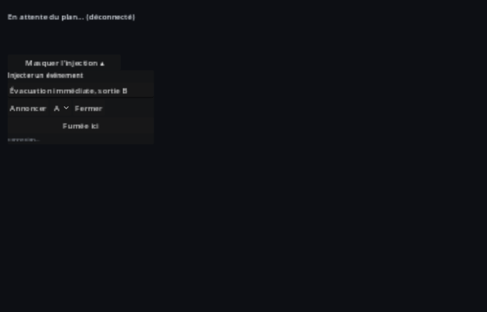
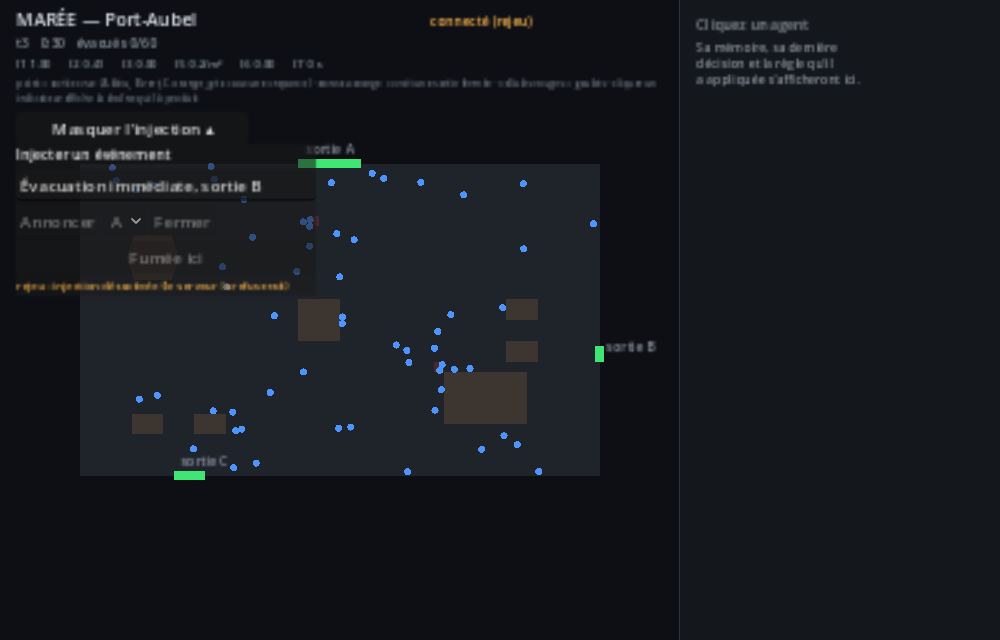
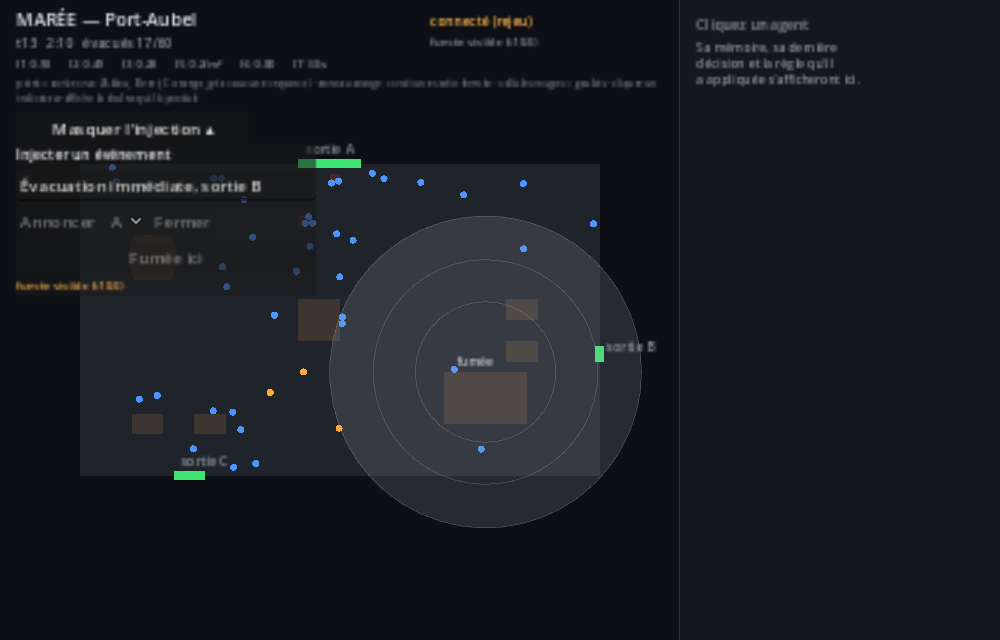
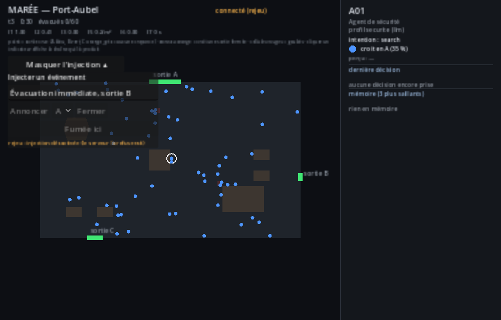

# État visuel de la scène Godot — base de comparaison

_Date : 2026-11-25. Tâche M-02. Ce document décrit l'existant, il ne prescrit
pas une refonte et n'en exécute aucune._

## 1. Comment les captures ont été faites

Deux outils ont été ajoutés, sans toucher ni à `godot/project/scenes/main.tscn`
ni à `godot/project/scripts/main.gd` :

- `tools/capture_scene.gd` — instancie `res://scenes/main.tscn` dans un
  `SubViewport` dimensionné par l'environnement, attend quelques frames,
  sauvegarde le PNG puis quitte ;
- `tools/capture.sh` — lance Godot depuis `godot/project/`, vérifie que le PNG
  existe et fait **plus de 5 Ko**, échoue sinon.

Commande réellement exécutée (capture à vide) :

```bash
tools/capture.sh
```

Pour les captures peuplées, `maree serve` a diffusé le run versionné
`demo_replay` à 1 tick/s ; chaque connexion rejoue le journal depuis t0 :

```bash
setsid env LANGCHAIN_TRACING_V2=false \
  uv run maree serve --run-id demo_replay --speed 1 >/dev/null 2>&1 < /dev/null &

MAREE_CAPTURE_WAIT_S=4 tools/capture.sh   # t≈3
MAREE_CAPTURE_WAIT_S=14 tools/capture.sh  # t≈13, après la fumée de t10
```

Réglages utilisés : `MAREE_CAPTURE_W=1000`, `MAREE_CAPTURE_H=640`,
`MAREE_CAPTURE_FRAMES=10`, résolution obtenue **1000 × 640** dans les quatre
PNG. `DISPLAY` est retiré par `capture.sh` : aucune fenêtre n'est ouverte.
L'option `--headless` est volontairement absente — son pilote factice renvoie
une texture nulle ; c'est `--rendering-driver opengl3` qui rend. Godot émet
des avertissements EGL sur le pilote NVIDIA de la machine, mais les quatre
images produites sont bien des PNG non vides (34 à 88 Ko).

Vérification croisée des légendes : l'outil journalise l'état reçu par le
client (`tick`, nombre d'agents, `smoke_active`) au moment de l'enregistrement ;
ces valeurs ont été recoupées avec `runs/demo_replay/events.jsonl` (t3 : 60
agents, 60 croyances en A, 0 évacué ; t13 : 60 agents, 17 évacués, croyances
56 A / 4 C, `world.smoke` à t10 en (44, 15), rayon 15 m).

## 2. Les captures

| Fichier | État journalisé | Taille | lecture |
|---|---|---|---|
| `main_20261125_173501_2827514.png` | `tick=? agents=0 fumée=false` | 34 372 o | démarrage, aucun serveur |
| `main_20261125_173616_2828461.png` | `tick=3.0 agents=60 fumée=false` | 76 905 o | plan peuplé, avant le danger |
| `main_20261125_173622_2828611.png` | `tick=13.0 agents=60 fumée=true` | 82 228 o | fumée visible, 17 sortis |
| `main_20261125_173720_2829306.png` | `tick=3.0 agents=60 fumée=false` | 87 640 o | même instant, agent A01 sélectionné |



*Capture 1 — 17:35:01 UTC. Fond bleu nuit (RGB ~13,15,20), message « En
attente du plan… » en haut à gauche, état `déconnecté`. Le plan n'étant pas
encore reçu, `_draw()` s'arrête là : ni HUD d'indicateurs, ni inspecteur à
droite. Le panneau d'injection (bouton « Masquer l'injection » et ses champs)
est présent, lui, car il est construit dans `_ready()`.*



*Capture 2 — 17:36:16 UTC, t3 (`0:30`, 0 évacué). L'esplanade 60 × 40 m est un
polygone gris sombre. Les obstacles (tour, fontaine, scène, stands) sont des
polygones marron à plat. Les trois sorties A/B/C sont de courts traits verts
sur le bord du plan, avec leur étiquette. Les 60 agents sont des disques
bleus : à t3 tous croient en A (`Grand Quai`), ce que confirme le journal
(60/60) et l'analyse des pixels (1 762 pixels bleu A, aucun vert B ni orange
C). Deux cellules de densité ont au moins 2 agents et apparaissent en rouge
translucide. En haut : titre « MARÉE — Port-Aubel », tick, temps simulé,
compteur d'évacués, six indicateurs cliquables (I1, I2, I3, I5, I6, I7) et
la légende des couleurs. À gauche, le panneau d'injection ; à droite, le
panneau « Cliquez un agent » encore vide.*



*Capture 3 — 17:36:22 UTC, t13 (`2:10`, 17 évacués sur 60). La fumée diffusée
à t10 est une grande nappe grise translucide avec trois anneaux concentriques
et l'étiquette « fumée », centrée sur (44, 15) avec un rayon de 15 m. Les
points des agents sortis ont disparu ; les croyances ont bougé : 56 bleus (A)
et 4 orange (C), sans vert (B). Le compte des pixels gris de fumée passe de
1 038 à t3 à 11 331 à t13. Le HUD affiche `t13 · 2:10 · évacués 17/60` et
les indicateurs mis à jour.*



*Capture 4 — 17:37:20 UTC, t3, avec `MAREE_SELECT=A01`. Le même plan, mais
A01 porte un contour blanc et le panneau de droite est rempli : identifiant,
profil « Agent de sécurité », intention, croyance et confiance, perçus,
dernière décision (déclencheur, raison, règle éventuelle) et mémoire. La zone
d'inspecteur passe de 281 à 934 couleurs distinctes entre la capture 2 et
celle-ci, ce qui confirme que le panneau n'était pas seulement dessiné à vide.*

## 3. Ce que la scène affiche aujourd'hui

La scène est un **schéma 2D de visualisation**, pas une scène de port. Le
client ne simule rien : tout vient des trames WebSocket du journal (`hello`
pour le plan, `snapshot` pour les agents, `world` pour la fumée et les
annonces, `indicators` pour le HUD). Ce qui est effectivement à l'écran :

- un plan au sol en vue de dessus, 60 × 40 m, avec six obstacles géométriques ;
- trois sorties segmentées et étiquetées A (`Grand Quai`), B (`Ruelle des
  Cordiers`), C (`Passage des Halles`) ; une sortie fermée serait rouge ;
- des disques pour les agents, colorés par la **sortie crue** (A bleu, B vert,
  C orange, gris si aucune croyance) — pas par leur profil ni leur position ;
- un anneau orange si l'agent croit une sortie fermée, un anneau blanc pour
  l'agent sélectionné ;
- des cellules rouges pour les goulots (`density_grid`) et une nappe grise
  cerclée pour la fumée ;
- un bandeau d'annonce temporaire, les récits du chroniqueur en bas ;
- un HUD avec six indicateurs où un clic demande au serveur la chaîne
  causale qui a produit la valeur (F6) ;
- un panneau d'injection à gauche (annonce, fermeture de sortie, fumée au
  dernier clic) — désactivé en rejeu, avec la raison affichée ;
- un inspecteur à droite : mémoire, perception, dernière décision et règle
  appliquée (D2).

La scène est lisible et informe sur le **modèle cognitif** : on voit qui croit
quoi, qui sort, où se forment les goulots. C'est son rôle actuel et il est
tenu.

## 4. Ce qui manque pour une scène de port crédible

- **Aucune géométrie de port** : pas de quai, de plan d'eau, de ponton, de grue,
  de navire, de entrepôt, de mouillage, de garde-corps. Les obstacles du plan
  sont des polygones plats sans hauteur ni matériau.
- **Aucune texture ni aucun prop utilisé** : 12 assets CC0 sont présents dans
  `godot/project/assets/` (8 matériaux PBR, 4 modèles : caisse, tonneau,
  seau, lampadaire) et le manifeste documente leur usage prévu, mais aucune
  référence `res://assets/...` n'existe dans la scène ni dans les scripts.
- **Aucune 3D, aucune caméra** : `main.tscn` ne contient qu'un `Node2D` et un
  script. Pas de vue 3/4, pas d'ortho isométrique, pas d'orbite, pas de zoom,
  pas de suivi d'agent, pas d'étage (le plan est un seul niveau).
- **Agents abstraits** : des cercles de ~3 pixels de rayon, sans corps,
  orientation, animation, ombre, ni état émotionnel visible. À 60 agents le
  schéma fonctionne, mais il ne montre pas une foule.
- **Effets schématiques** : la fumée est un disque à anneaux, pas une
  simulation volumétrique ; les goulots sont des cases, pas une chaleur
  continue ; les sorties sont des traits, pas des portes avec signalétique.
- **Aucun éclairage ni ambiance** : pas de ciel, de soleil, d'HDRI, de lumière
  directionnelle, d'ombre portée, de surface d'eau animée. Le fond est une
  couleur unie.
- **Pas de comparaison visuelle** : un seul run à la fois, pas de vue
  côte à côte, pas d'export vidéo, pas d'image de référence figée pour
  détecter une régression (les captures ci-dessus ne sont pas encore des
  « golden images »).

## 5. Liste ordonnée des actions à mener (non exécutées ici)

1. **Fixer le contrat visuel et la correspondance des IDs** : choisir la vue
   (2,5D orthographique ou 3/4), définir comment les IDs du plan (`exits`,
   `obstacles`, `zones`) et les positions mètres du journal alimentent la
   scène, et geler la résolution de référence (1000 × 640 ici).
2. **Construire le décor du quai** à partir des assets déjà téléchargés et
   du WorldSpec : dalle béton, platelage, tôle ondulée, métal rouillé, sable,
   caisse/tonneau/seau/lampadaire ; donner une hauteur aux obstacles et
   matérialiser les trois sorties (+ signalétique A/B/C).
3. **Ajouter lumière, ciel et eau** : lumière directionnelle, ombres, HDRI
   discret, plan d'eau animé, brouillard ou brume portuaire légère, en
   gardant le rendu GL Compatibility (iGPU, pas de Vulkan).
4. **Remplacer les disques par des agents instanciés** (60 low-poly animés),
   avec orientation selon l'intention, sélection, suivi au clic et
   conservation des couleurs de croyance ; conserver les anneaux
   « sortie crue fermée » et « sélectionné ».
5. **Passer les signaux en 3D** : fumée volumétrique ou particules liées à la
   position du monde, portes qui se ferment réellement, goulots en champ de
   densité au sol — sans recalculer ces valeurs côté client.
6. **Garder le contrat d'affichage existant** (D1/D2/D3, six indicateurs
   cliquables, panneau d'injection, inspecteur) et vérifier qu'il survive au
   passage 3D ; le client reste consommateur du journal.
7. **Institutionnaliser la comparaison** : versions successives des quatre
   captures ci-dessus, seuil de taille et contrôle de non-vide déjà dans
   `tools/capture.sh`, puis tests de non-régression visuelle et budget FPS à
   60 agents sur l'iGPU.

## 6. Périmètre et limites de cette tâche

- Seuls `tools/`, `captures/` et `docs/visuel/` ont été écrits. Le journal
  `demo_replay` a été lu, jamais modifié.
- Les captures peuplées viennent d'un **rejeu** (`maree serve`, `live=false`) :
  le panneau d'injection y est désactivé par construction. Une capture en
  `maree live` resterait à faire pour documenter D3 en image.
- Les légendes « t3 » et « t13 » sont les ticks journalisés par l'outil au
  moment du `save_png`, pas des estimations faites a posteriori.
- Le rendu est un `SubViewport` OpenGL sans fenêtre visible : ce n'est pas
  une capture d'écran d'une session graphique, mais bien l'image que le
  client produit, à résolution fixe.
