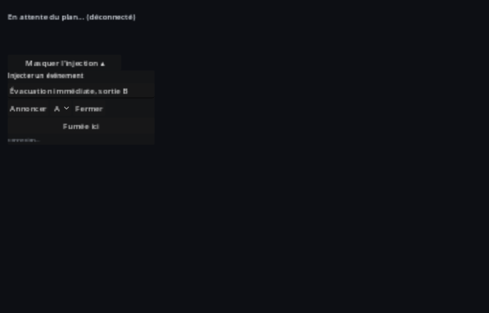
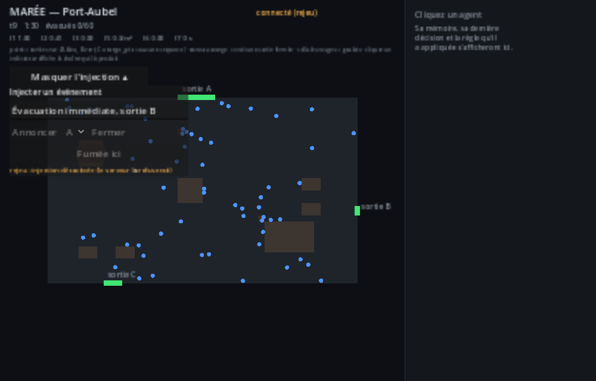
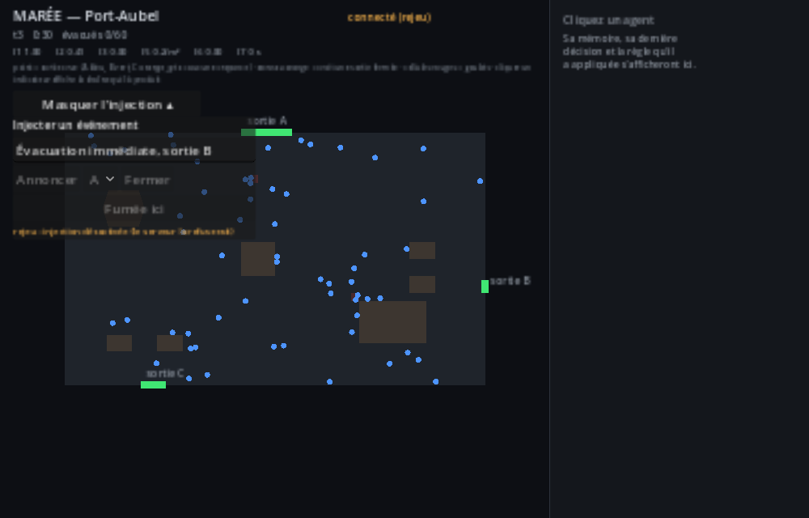

# Évaluation visuelle de la scène — M-03

_Date : 2026-11-25. Tâche M-03. Cette évaluation mesure l'état visuel actuel ; elle ne modifie rien dans la scène._

## Méthode

- Outil : `pilot-vision --json` (modèle de vision réel, clé OpenRouter présente dans l'environnement).
- Captures produites par `tools/capture.sh` (`--rendering-driver opengl3`, sans `--headless`).
- Grille fixe imposée à chaque capture : **Lisibilité**, **Densité visuelle**, **Cohérence de la palette**, **Profondeur (perspective, ombres)**, **Éléments attendus mais absents pour une scène de port**. Note de 0 à 10 par critère + actions concrètes.
- Réponses brutes conservées dans `docs/visuel/reponses-vision/`.

## Captures évaluées

### Capture 1 — démarrage (aucun serveur connecté)

*Fichier : `captures/m03_01_demarrage.png`. Réponse brute : `docs/visuel/reponses-vision/m03_01_demarrage.json`.*

> Écran noir avec une interface de commande textuelle en haut à gauche. Aucune simulation de foule ni aucune scène de port n'est visible ; le statut indique une déconnexion.

### Capture 2 — après quelques secondes (t≈9, scène peuplée)

*Fichier : `captures/m03_02_apres_quelques_secondes.png`. Réponse brute : `docs/visuel/reponses-vision/m03_02_apres_quelques_secondes.json`.*

> Vue 2D top-down d'une simulation d'évacuation dans l'outil MARÉE. Des agents bleus se déplacent sur un fond sombre avec quelques obstacles bruns et des sorties vertes, overlappés par une interface de debug textuelle chargée.

### Capture 3 — panneau d'injection ouvert (t≈3, scène peuplée)

*Fichier : `captures/m03_03_panneau_injection_ouvert.png`. Réponse brute : `docs/visuel/reponses-vision/m03_03_panneau_injection_ouvert.json`.*

> Vue 2D top-down de la simulation MARÉE à Port-Aubel avec le panneau d'injection ouvert à gauche. Des agents bleus se déplacent autour d'obstacles bruns vers trois sorties vertes (A, B, C) sur un fond sombre quasi vide.

## Tableau des notes par critère et par capture

| Critère | C1 | C2 | C3 | Moyenne |
|---|---:|---:|---:|---:|
| Lisibilité | 6 | 5 | 6 | 5.7 |
| Densité visuelle | 2 | 4 | 4 | 3.3 |
| Cohérence de la palette | 7 | 6 | 6 | 6.3 |
| Profondeur (perspective, ombres) | 0 | 2 | 2 | 1.3 |
| Éléments attendus mais absents pour une scène de port | 0 | 1 | 2 | 1.0 |
| **Moyenne globale** |  |  |  | **3.5** |

_C1 = démarrage ; C2 = après quelques secondes ; C3 = panneau d'injection ouvert._

## Détail par critère

### Lisibilité

- **C1 (6/10)** — Le texte blanc sur fond sombre est lisible, mais l'absence de contenu visuel rend l'écran peu informatif pour une évaluation de scène.
- **C2 (5/10)** — Les agents (points bleus) et sorties (barres vertes) sont identifiables, mais les textes d'interface se chevauchent et les labels sont trop petits pour une lecture rapide de la situation.
- **C3 (6/10)** — Les agents et les sorties restent distinguables, mais le panneau UI chevauche partiellement la zone de simulation et les rectangles bruns se fondent trop dans le fond sombre.

### Densité visuelle

- **C1 (2/10)** — Presque vide : seulement un petit panneau d'UI texte sur un fond noir uniforme.
- **C2 (4/10)** — Très peu d'éléments graphiques dans l'aire de simulation ; l'espace vide domine, seuls quelques points et rectangles ponctuent la scène, hormis l'UI latérale chargée.
- **C3 (4/10)** — Scène très clairsemée avec seulement 50 points bleus et quelques blocs bruns sur de vastes zones vides ; peu d'ancrages visuels pour structurer l'espace.

### Cohérence de la palette

- **C1 (7/10)** — Noir et gris/texte blanc cohérents pour une interface technique, mais sans couleur ni accentuation.
- **C2 (6/10)** — Palette sombre et cohérente (bleu agents, brun obstacles, vert sorties), mais reste générique et sans lien visuel marqué avec un univers portuaire.
- **C3 (6/10)** — Thème sombre cohérent (fond noir, agents bleus, sorties vertes), mais les teintes brunes des obstacles n'évoquent pas spécifiquement un environnement portuaire.

### Profondeur (perspective, ombres)

- **C1 (0/10)** — Aucune perspective, ombre ou élément de scène 2D ; il s'agit uniquement d'UI plate.
- **C2 (2/10)** — Vue purement top-down 2D sans perspective, sans ombres portées ni calages de plans ; la scène est totalement plate.
- **C3 (2/10)** — Vue purement 2D plate sans perspective, sans ombres portées et sans indice de relief ; les obstacles et agents semblent flotter sur le fond.

### Éléments attendus mais absents pour une scène de port

- **C1 (0/10)** — Aucun élément de port (eau, quais, bateaux) ni aucune foule n'est présent ; la scène de simulation n'est pas chargée.
- **C2 (1/10)** — Aucun élément spécifique à un port n'est visible : pas d'eau, de bateaux, de quais ni de conteneurs ; seuls des formes géométriques génériques tiennent lieu de décor.
- **C3 (2/10)** — Très peu d'éléments portuaires reconnaissables : pas d'eau, quais, grues, conteneurs ou bateaux ; on dirait plutôt un espace abstrait avec des blocs génériques.

## Ce que la vision a vu que je n'avais pas vu

La comparaison se fait avec `docs/visuel/ETAT-VISUEL.md` (M-02), qui décrit la scène comme un schéma 2D de visualisation. Les points ci-dessous sont ceux que l'évaluation vision a mis en avant avec plus de netteté ou que M-02 n'avait pas formulés comme défauts visuels :

- **La capture de démarrage est quasi vide pour un œil externe.** M-02 la décrit factuellement (« message d'attente, panneau d'injection présent »). La vision la note 0/10 sur la profondeur et les éléments de port, et 2/10 en densité visuelle : sans plan chargé, l'écran ne communique pas du tout la nature du projet.
- **Le panneau d'injection chevauche la zone de simulation.** La vision le signale explicitement en C2 et C3 (lisibilité 5-6/10) : le panneau à gauche masque une partie de l'esplanade et entre en concurrence avec les labels des sorties. M-02 mentionne sa présence, pas son coût visuel.
- **Les obstacles bruns se fondent dans le fond sombre.** Le contraste obstacle/fond est insuffisant ; la vision le relève en C3. À l'écran, les blocs « tour, fontaine, scène, stands » sont des formes géométriques difficiles à identifier sans lire le code ou le plan mental du projet.
- **L'absence totale de référentiel portuaire est pénalisante.** Les notes 0, 1, 2/10 sur « Éléments attendus mais absents pour une scène de port » confirment que la scène est lue comme un espace abstrait générique, pas comme un port. M-02 le dit (« schéma 2D de visualisation, pas une scène de port »), mais la vision le chiffre capture par capture.
- **Les labels et textes d'interface se chevauchent.** En C2, la vision note que les labels de sorties et bulles de texte masquent les agents/flux. C'est un défaut de lisibilité opérationnelle, pas seulement esthétique.
- **Aucune ombre ni indice de relief.** La profondeur est notée 0-2/10 sur les trois captures. Même dans une vue top-down 2D, des ombres portées simples aideraient à distinguer agents, obstacles et zones.

## Éléments manquants signalés par la vision

- Scène de port (quais, eau, bateaux)
- Foule d'agents/personnes
- Plan d'évacuation visuel
- Connexion au serveur
- Eau / bassin portuaire
- Bateaux ou navires
- Quais et docks
- Conteneurs ou grues
- Ombres portées
- Textures de sol (bitume, caillebotis)
- bassin d'eau / mer
- quais et bordures portuaires
- grues ou portiques
- conteneurs
- bateaux amarrés
- signalisation de quai

## Actions concrètes classées par impact visuel

| Priorité | Impact | Effort | Action | Captures | Détail |
|---:|---|---|---|---|---|
| 1 | fort | faible | Réorganiser l'interface de debug | C2 | Décaler les labels de sorties et les bulles de texte pour éviter qu'ils ne masquent les agents et les flux de déplacement. |
| 2 | fort | moyen | Intégrer un plan d'évacuation visuel | C1 | Superposer ou afficher le plan avec sorties de secours, zones de rassemblement et itinéraires. |
| 3 | fort | moyen | Ajouter une couche de sol texturée eau/quai | C2 | Remplacer le fond uni par un dégradé bleu sombre pour l'eau et des zones grises pour les quais afin d'ancrer la scène dans un port. |
| 4 | fort | moyen | Ajouter une zone d'eau texturée en fond (bassin portuaire) | C3 | Remplacer le fond noir uni par une texture d'eau sombre avec des quais le long des sorties A, B et C. |
| 5 | fort | moyen | Remplacer les rectangles bruns par des conteneurs et entrepôts stylisés | C3 | Utiliser des sprites de conteneurs empilés et de bâtiments portuaires pour les obstacles bruns actuels. |
| 6 | fort | eleve | Charger la scène de port avec les agents de foule | C1 | Afficher le fond de port (quais, eau, issues) et instancier les personnages de la simulation MARÉE. |
| 7 | moyen | faible | Rétablir ou simuler la connexion serveur | C1 | Remplacer le texte '(déconnecté)' par un indicateur de statut connecté ou lancer le mode hors-ligne avec données par défaut. |
| 8 | moyen | faible | Ajouter des ombres simples sous agents et obstacles | C2 | Ajouter une ellipse sombre décalée sous chaque agent et obstacle pour renforcer la perception de relief. |
| 9 | moyen | faible | Distinguer les sorties par icônes portuaires | C2 | Remplacer les barres vertes par des symboles de porte de quai ou d'escalier de secours avec bulles légendaires. |
| 10 | moyen | faible | Ajouter des ombres portées sous agents et obstacles | C3 | Activer les ombres Godot 2D ou ajouter des instances d'ombre décalées sous chaque agent et obstacle. |
| 11 | moyen | faible | Réduire l'opacité ou décaler le panneau d'injection | C3 | Rendre le fond du panneau semi-transparent ou l'ancrer en dehors de la zone de simulation pour ne pas masquer les agents. |
| 12 | moyen | moyen | Remplacer les obstacles bruns par des conteneurs/bâtiments portuaires | C2 | Utiliser des sprites rectangulaires aux couleurs de conteneurs (rouge, bleu, blanc) avec détails simples pour suggérer l'environnement portuaire. |
| 13 | moyen | moyen | Créer des quais et bordures le long des sorties | C3 | Placer des murs de quai entre la zone d'eau et les sorties A/B/C pour ancrer visuellement les issues dans l'environnement portuaire. |

## Synthèse

La scène est lisible comme **outil de debug 2D** (agents, sorties, fumée, HUD, injection), mais elle n'est pas lue comme une **scène de port**. La moyenne globale est de 3.5/10, tirée vers le bas par la profondeur (1,3/10) et l'absence d'éléments portuaires (1,0/10). Les points les plus défendables en l'état sont la cohérence de palette technique (6,3/10) et la lisibilité fonctionnelle des agents/sorties quand le plan est chargé (5,7/10).

La capture de démarrage (C1) est un cas à part : sans serveur, le client n'affiche pas le plan, donc l'évaluation porte surtout sur un état vide. Les captures C2 et C3 sont plus représentatives du rendu en fonctionnement.

## Limites de cette évaluation

- L'évaluation porte sur des captures statiques 2D ; elle ne mesure ni la lisibilité en mouvement, ni la compréhension des indicateurs au fil du temps.
- La grille demandait une lecture « scène de port » ; le projet MARÉE est bien une simulation de port, mais le client Godot actuel est un visualiseur schématique. Les notes basses sur les éléments portuaires reflètent cet écart, pas un bug du moteur de simulation.
- `pilot-vision` a été appelé avec `--json` et le même gabarit de prompt pour les trois captures. Les réponses brutes sont conservées sans réécriture dans `docs/visuel/reponses-vision/`.
- Aucune modification n'a été apportée à `godot/project/scenes/main.tscn`, aux scripts du jeu, ni aux assets.

## Correction de cadrage (ajoutée après coup par le pilote)

La grille imposée à la vision demandait « les éléments attendus pour une scène de
port ». C'était une erreur de cadrage : le projet est l'évacuation d'une foule
**dans un bâtiment** (centre commercial, grand musée), sur plusieurs étages. La
ligne « éléments portuaires » et les actions 3, 4, 5, 9, 12, 13 sont donc
**nulles** : elles décrivent un décor qui n'est pas le bon.

Ce qui reste valable, et qui servira de référence « avant » :

- lisibilité 5,7/10, densité 3,3/10, palette 6,3/10, **profondeur 1,3/10** ;
- les actions 1, 2, 7, 8, 10, 11 (interface, ombres, panneau) restent pertinentes ;
- le constat de fond : le client est lisible comme **outil de debug**, pas comme
  **scène**. C'est exactement ce que le rendu isométrique doit corriger.
